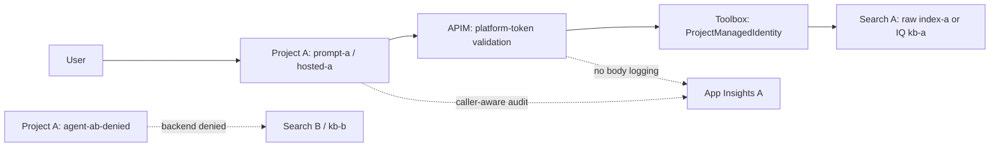
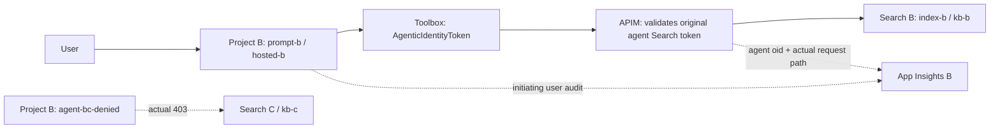
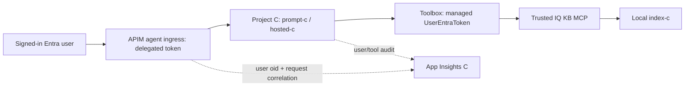

# Foundry agents, Toolbox and AI Gateway: the A/B/C identity lab

An isolated Microsoft Foundry lab demonstrating **project identity, agent identity and end-user identity**, real authorization denials, and caller-aware telemetry.

**Only the Foundry-agent setup is included here.** No LiteLLM gateway, unrelated gateway comparisons, old slide decks, tenant configuration, credentials, consent URLs, or raw customer/test conversations are included.

## TL;DR: results

| Scenario | Result from the October 9, 2026 live lab |
| --- | --- |
| **A: project identity** | Prompt and hosted agents retrieve from Search A / IQ KB A using project-A credentials. APIM before Toolbox works. |
| **B: agent identity** | Prompt and hosted agents retrieve with their distinct agent identities. **Toolbox -> APIM -> Search/IQ** works; APIM JWT claims match the respective agent. |
| **C: user identity** | Prompt and hosted IQ retrieval works with managed **`UserEntraToken` / OBO**. **User -> APIM -> agent -> Toolbox -> IQ** preserves the working flow and gives APIM the initiating user's `oid`. |
| **AB / BC deny paths** | AB cannot query B; BC cannot query C. Assertions use actual backend authorization errors, not model-generated refusal text. |
| **Orchestrator in A** | Calling Prompt A succeeds. The tested Hosted A A2A target explicitly returns `HostedAgentNotSupported`. |
| **Confidential agent in B** | Question logged; answer returned to caller but absent from six telemetry tables in the corrected test window. `store:false` is enforced even when the caller asks for `store:true`. |
| **Telemetry isolation** | Three App Insights / Log Analytics pairs; no foreign-project custom events in the tested windows. |

**Boundaries:** separate Search **services**, not index isolation inside one shared KB; no two-human or document-ACL proof; C raw Search managed-user calls remain broker-rejected. The generic OAuth fallback is **optional and consent-gated**, not required by the working C IQ path. No claim of zero provider/internal retention.

The results above are historical measured behavior, not a promise that a new subscription, region, API version or later service rollout behaves identically. This standalone extraction is checked with offline tests and Bicep compilation; publishing this repository does **not** redeploy or revalidate Azure resources.

## Does this use the APIM "AI Gateway SKU"?

**No. The verified instance uses `StandardV2`, capacity 1.** This repository's optional APIM template also creates **Standard v2**, and the deployment wrapper checks that tier.

Two different concepts are easy to confuse:

| Term | Meaning | This lab |
| --- | --- | --- |
| **AI gateway capabilities in APIM** | Capabilities for model, agent, MCP and A2A traffic on API Management tiers; individual capabilities have tier-specific availability. | Uses MCP/HTTP APIs, Entra validation, XML policies, correlation and App Insights diagnostics on Standard v2. |
| **Dedicated AI Gateway tier (preview)** | A separate AI-focused offering with its own resource/runtime model, runtime access keys and policy experience. | **Not deployed or validated.** Do not switch the SKU and assume these managed-user and policy flows remain equivalent. |

There is no Foundry **model-inference gateway association** configured by this lab. Its APIM APIs govern agent/tool/data hops; it does not automatically route all model calls through APIM or enable model token metering/caching.

Official references, checked October 15, 2026:
[APIM AI gateway capabilities](https://learn.microsoft.com/azure/api-management/genai-gateway-capabilities) and
[dedicated AI Gateway tier overview](https://learn.microsoft.com/azure/api-management/ai-gateway-overview).

## Architecture schemas


Editable source: [Excalidraw diagram](docs/architecture.excalidraw). Regenerate both formats with `python docs\generate_diagrams.py`.

### A - Project identity



The Search credential is project A's MI. Agents can share that data access; merely creating separate agents does not make their data permissions distinct.

### B - Agent identity



APIM does not swap in its own Search identity or perform an OBO exchange on this path. Search enforces the original agent's permissions.

### C - End-user identity



**APIM is before the agent**, not between the agent and Toolbox. Toolbox obtains the downstream user token on its trusted first-party path. Project C and its agents receive no Search data grants.

## Resources and agents

The foundation creates three new projects in an **existing Foundry account**, three isolated keyless Basic Search services, and three App Insights/workspace pairs. It reuses an existing **`gpt-4o-mini` deployment** and **Standard v2 APIM**.

| Project | Agents | Search data authorization |
| --- | --- | --- |
| `abc-a` | `prompt-a`, `hosted-a`, `agent-ab-denied`, `a-orchestrator` | Project A MI -> Search A only |
| `abc-b` | `prompt-b`, `hosted-b`, `b-confidential`, `agent-bc-denied` | Each B agent -> Search B only; not project B MI |
| `abc-c` | `prompt-c`, `hosted-c` | Signed-in user's permissions; no project/agent data-reader grant |

Each Search service contains `index-a/b/c`, local source `ks-a/b/c`, and `kb-a/b/c`. One source/index belongs to each KB. The signed-in provisioning user receives Search write permissions for seeding; that user is not a second-human deny test.

**This is a public-endpoint preview lab, not a production network-isolation baseline.** No VNet/private endpoints are provisioned. Running it incurs Search, hosted-agent/model, APIM (if created), and telemetry charges.

## IaC and code map

| File | Responsibility |
| --- | --- |
| [infra.bicep](infra.bicep), [projects.bicep](projects.bicep) | Search services, projects/MIs, role assignments, three telemetry sinks; existing Foundry/APIM references |
| [apim.bicep](apim.bicep) | **Optional** creation of a new Standard v2 service; not the dedicated AI Gateway preview tier |
| [deploy.ps1](deploy.ps1) | Foundation deployment; discovers account location and APIM tier; retains runtime agent/tool state on redeployment |
| [setup.ps1](setup.ps1) | Sequential end-to-end primary setup using existing Foundry/model/APIM |
| [search_resources.py](search_resources.py), [provision.py](provision.py) | Index/source/KB schemas, deterministic synthetic fixtures, auth connections and Toolboxes |
| [publish_agents.py](publish_agents.py) | Agent versions, role grants, MCP relay APIs and explicit working default routes |
| [hosted/main.py](hosted/main.py) | MAF hosted runtime, tool calls, user audit, source activity, orchestration and confidential middleware |
| [configure_agent_gateway.py](configure_agent_gateway.py) | B's downstream APIM data gateway |
| [configure_user_ingress.py](configure_user_ingress.py) | C's user-facing agent APIM API |
| [policies/toolbox-proxy-policy.xml](policies/toolbox-proxy-policy.xml) | A's upstream Toolbox relay policy, with zero body logging |
| [verify.ps1](verify.ps1), [test_routes.py](test_routes.py), [verify_showcase.py](verify_showcase.py) | Actual route/marker/denial tests, identity correlation and privacy scans |

Raw Search uses a managed **OpenAPI-to-MCP adapter**, or B hosted REST tools, rather than an invented native index MCP URL. IQ uses the real KB MCP endpoint. For the tested native Azure AI Search tool, documented account-MI behavior is not assumed to be project/agent/user identity.

## Deploy

### Prerequisites

- **Windows + PowerShell**, Python 3.12, Azure CLI with Bicep, and Git. Hosted code targets Python 3.13. Local config locking uses Windows `msvcrt`.
- An existing Foundry account supporting projects, hosted agents, Toolbox and the preview Search/IQ APIs, with a `gpt-4o-mini` model deployment. The deployment name can differ; the model family here is fixed.
- An existing **Standard v2** APIM service, or explicitly create one using the optional template below.
- Resource deployment and role-assignment permissions on the lab RG, existing Foundry account/projects, and APIM configuration. Contributor alone cannot create RBAC assignments.
- The intended lab tenant/user signed into Azure CLI. Hosted-agent regional availability, quota and preview access are prerequisites, not bypassed by these scripts.

Choose an account without conflicting `abc-a/b/c` projects, or deliberately reuse this lab's resources. Do not attach the script to unrelated projects. Role mismatches in B/C fail explicitly instead of silently revoking existing grants.

```powershell
git clone https://github.com/yelghali/foundry-agents-toolbox-ai-gateway.git
Set-Location .\foundry-agents-toolbox-ai-gateway
python -m venv .venv
.\.venv\Scripts\Activate.ps1
python -m pip install -r requirements-dev.txt
az login --tenant "<tenant-id>"
az account set --subscription "<subscription-id>"

.\setup.ps1 `
  -SubscriptionId "<subscription-id>" `
  -FoundryResourceGroup "<existing-foundry-rg>" `
  -FoundryAccountName "<existing-foundry-account>" `
  -ApimResourceGroup "<existing-apim-rg>" `
  -ApimName "<existing-standard-v2-apim>" `
  -ResourceGroup "rg-foundry-agents-toolbox" `
  -SearchLocation "swedencentral" `
  -ModelDeployment "gpt-4o-mini"
```

No Azure resources are deployed by cloning or pushing this repository. `setup.ps1` is the explicit deployment action. It does not create the Foundry account/model or delete Azure resources. It reuses and modifies the named lab projects/APIs.

Optional **new, billable** Standard v2 APIM, before running setup:

```powershell
az group create --name "<new-apim-rg>" --location eastus2
az deployment group create --resource-group "<new-apim-rg>" `
  --template-file .\apim.bicep `
  --parameters apimName="<globally-unique-name>" `
    publisherEmail="<your-email>" publisherName="<your-team>"
```

The initial live lab used Foundry in East US 2 and Search in Sweden Central. These are historical working regions, not a guarantee of current subscription capacity.

### Incremental workflow

`deploy.ps1` creates the foundation only. Then provision **all three cohorts** before publishing the showcase agents:

```powershell
python .\provision.py
python .\publish_agents.py --cohort a --routes direct toolbox apim --showcase
python .\publish_agents.py --cohort b --routes direct toolbox --showcase
python .\publish_agents.py --cohort c --routes direct toolbox
python .\configure_agent_gateway.py
python .\publish_agents.py --cohort b --routes data-gateway
python .\configure_user_ingress.py
```

Default agent endpoints are pinned to A `apim`, B `data-gateway`, C `toolbox` once those routes exist. Publish sequentially within a cohort. Tool/agent publication creates versions; deployment alone is never treated as a passed retrieval test.

## Tests and observability

```powershell
# No Azure calls:
python -m unittest test_local -v
az bicep build --file .\infra.bicep
az bicep build --file .\apim.bicep

# Live, authenticated, billable model/tool calls:
.\verify.ps1

# Rerun after Azure Monitor ingestion delay:
python .\verify_showcase.py --privacy --store-request --audits --gateway --user-ingress
```

The offline suite covers forced no-store, malformed/stateless inputs, real backend error classification, consent URL handling, APIM update headers, config merging/Windows sharing retries, local schemas and portable dependencies. [CI](.github/workflows/validate.yml) runs offline checks only; it does not deploy resources or require Azure/GitHub secrets.

Live assertions check exact seeded markers, actual backend denial, version-pinned sessions, observed APIM principals and user correlation. The confidential scan covers `AppEvents`, `AppTraces`, `AppRequests`, `AppDependencies`, `AppExceptions` and `AppGenAIContent`, including dynamic properties. Ingestion can lag; missing evidence fails the check, not a success-shaped fallback.

In Azure: open the corresponding **App Insights -> Logs** or **Log Analytics -> Logs**. In Foundry: select the project, then **Observability -> Traces**. Custom `AppEvents` need not appear as native Foundry trace trajectories. See [log queries and privacy details](docs/observability.md).

Local `.config.json` contains telemetry settings and runtime state; `evidence/` can contain user queries and model outputs. Both are ignored. Keep them private. The repository deliberately publishes the historical **results summary**, not the original tenant's runtime files or conversations.

## Limitations and negative findings

- **One KB exposing several indexes:** not proven to enforce per-index RBAC. Earlier index-only reader grants failed KB retrieve even for a single local source; these demonstrations isolate at Search-service scope.
- **Document-level security:** `x-ms-query-source-authorization` and ingestion-time permission metadata are separate preview controls; no document-ACL scenario is implemented/tested here.
- **C raw Search:** both OpenAPI and native Search managed-user probes were broker-rejected as untrusted destinations. C's verified path is IQ.
- **APIM in the wrong hop:** B APIM-before-Toolbox lost required agent context; C APIM-before-Toolbox managed OBO failed. The working placements above are deliberate.
- **APIM visibility:** actual request URL/path/principal can be logged at the hop it sees. APIM before a KB does **not** observe that KB's internal local-index subqueries.
- **One human:** no two-human allow/deny proof. C's successful tests also checked the absence of project/agent Search data grants.
- **Confidentiality:** container flags alone initially leaked model content through Foundry server traces. The corrected confidential agent uses the direct model endpoint, question-only audit and enforced `store:false`. Older test traces remain. This is not a zero-provider-retention guarantee.
- **Hosted A2A:** the measured target returned `HostedAgentNotSupported`; the orchestrator preserves that actual platform result. Prompt-peer invocation passed.
- **Optional OAuth:** [configure_user_fallback.py](configure_user_fallback.py) adds separate Entra OAuth connections and a Toolbox/APIM comparison. It requires `azd`, application-registration permissions and fresh per-connection user consent. It has seven-day lab credentials and is **not part of setup**. The hosted consent continuation requires `--request-store`; never apply that bootstrap to the confidential agent. [open_user_consent.py](open_user_consent.py) validates client, scope, callback and expiry before opening the real consent URL.
- [configure_native_user_search.py](configure_native_user_search.py) preserves the separate failed native-user experiment; it is not enabled by default.

## References

- [Connect agents to Foundry IQ](https://learn.microsoft.com/azure/foundry/agents/how-to/foundry-iq-connect)
- [Hosted agent with IQ and Toolbox](https://learn.microsoft.com/azure/foundry/agents/quickstarts/quickstart-foundry-iq-hosted-agent)
- [Tool authentication and identities](https://learn.microsoft.com/azure/foundry/agents/how-to/tools/tool-authentication)
- [Foundry trace data handling](https://learn.microsoft.com/azure/foundry/observability/concepts/trace-data)
- [Sensitive trace content](https://learn.microsoft.com/azure/foundry/observability/how-to/traces-sensitive-content)
- [Model privacy and retention](https://learn.microsoft.com/azure/foundry/responsible-ai/openai/data-privacy)
- [Search document permission enforcement](https://learn.microsoft.com/azure/search/search-query-access-control-rbac-enforcement)
