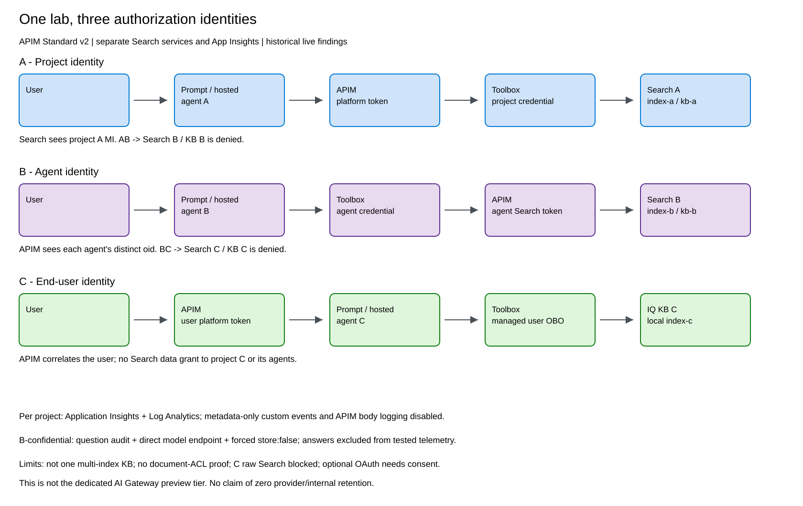
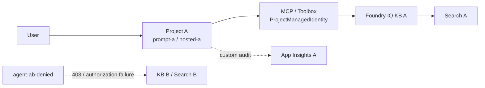
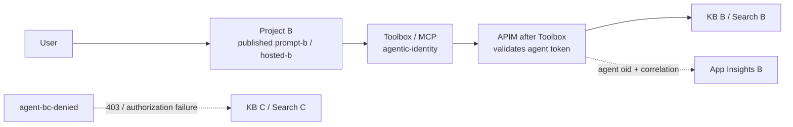
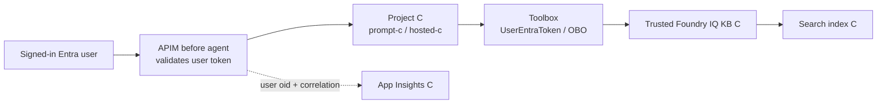
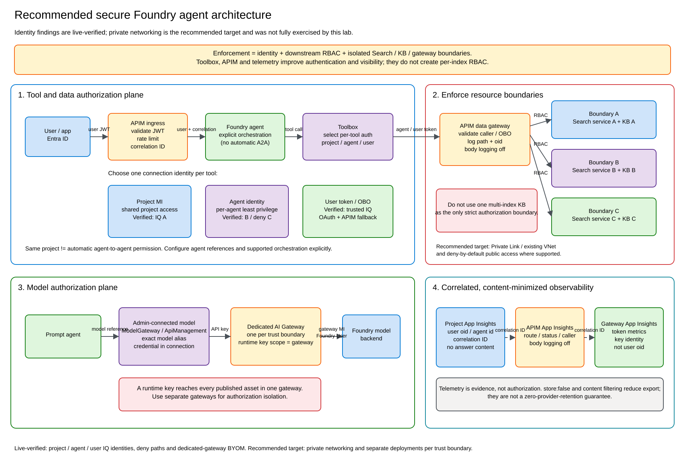

# Foundry agents identity lab

Reference implementation for Microsoft Foundry agents using three authorization models:

- **A - project identity**
- **B - agent identity**
- **C - signed-in user identity**

The lab includes real allow/deny tests, Foundry IQ and Azure AI Search, Toolbox, APIM, per-project telemetry, and a Bring Your Own Model path through the dedicated AI Gateway tier.

## Prompt agent -> Foundry IQ: project or agent identity?

**Both are possible, but they require different MCP connection authentication.**

| Path | Identity used |
| --- | --- |
| Current direct Foundry IQ prompt-agent recipe | `ProjectManagedIdentity` |
| Prompt agent with an `agentic-identity` MCP connection | Agent identity |
| Hosted agent + Toolbox IQ quickstart | Deployed agent managed identity |

Important details:

- The direct [Foundry IQ connection guide](https://learn.microsoft.com/azure/foundry/agents/how-to/foundry-iq-connect) grants Search access to the **project managed identity**. All agents using that connection share its permissions.
- Prompt agents support agent identity for MCP tool authentication. **Unpublished agents share the project's development agent identity; a published agent gets a distinct identity.**
- For per-agent isolation, publish the prompt agent, configure the MCP connection with `agentic-identity`, grant the published identity `Search Index Data Reader`, and test both an allowed and denied resource.
- Microsoft documents `agentic-identity` specifically for hosted agent -> Toolbox -> Foundry IQ. For prompt agents, the support is composed from the general MCP/agent-identity model; revalidate it in your region and API version. Scenario B is this lab's measured proof.

## Scenarios A, B and C

Measured overview:



Editable source: [docs/architecture.excalidraw](docs/architecture.excalidraw).

### A - shared project identity



- **Goal:** all A agents share the same data permissions.
- **Allow:** Search A and KB A.
- **Deny:** agent AB is configured for B but project A has no B data role.
- **Boundary:** separate agents do not create separate permissions when the connection uses project identity.
- **Code/test:** [project/Search RBAC](infra.bicep), [IQ connection setup](provision.py), [A and AB agents](publish_agents.py), [live allow/deny suite](verify.ps1).

### B - least-privilege agent identity



- **Goal:** agents in one project have different backend permissions.
- **Allow:** each approved B agent identity receives access to B.
- **Deny:** agent BC has no C data role.
- **APIM placement:** after Toolbox, APIM observes the downstream agent identity.
- **Code/test:** [agent publication and RBAC](publish_agents.py), [agent-token APIM path](configure_agent_gateway.py), [backend-result assertions](test_routes.py), [live allow/deny suite](verify.ps1).

### C - signed-in user identity



- **Goal:** authorization follows the signed-in user.
- Project C and its agents have no Search data roles.
- The managed OBO path was verified for trusted Foundry IQ. The broker rejected Microsoft user tokens sent to the tested arbitrary Search/custom MCP endpoints; use generic OAuth plus APIM OBO for customer-controlled endpoints.
- APIM is before the agent to observe the human caller. APIM cannot see the KB's internal Search source queries.
- **Code/test:** [`UserEntraToken` IQ connection](provision.py), [user-token APIM ingress](configure_user_ingress.py), [backend-result assertions](test_routes.py), [live OBO suite](verify.ps1).

## TL;DR findings

| Question | Result | Code / test |
| --- | --- | --- |
| Prompt agent -> IQ with project identity? | **Yes.** This is the direct documented recipe. | [Connection](provision.py), [agents](publish_agents.py), [live test](verify.ps1) |
| Prompt agent -> IQ with its own identity? | **Yes, with an `agentic-identity` MCP connection and a published agent.** Unpublished agents share a development identity. Revalidate the exact IQ composition in your environment. | [Identity/RBAC](publish_agents.py), [APIM path](configure_agent_gateway.py), [live test](verify.ps1) |
| Agents in one project communicate automatically? | **No.** Explicit orchestration is required. Prompt-agent reference passed; the tested hosted target returned `HostedAgentNotSupported`. | [Orchestrator](publish_agents.py), [runtime result](hosted/main.py), [assertion](verify.ps1) |
| Can one KB with indexes A and B enforce strict per-index isolation? | **Not proven. Do not use it as the only boundary.** Prefer separate Search services/KBs, or implement and test document-level permission enforcement. | [Isolated services/RBAC](infra.bicep), [KBs](provision.py), [deny tests](verify.ps1) |
| Did the deny paths really fail? | **Yes.** AB -> B and BC -> C were asserted from backend authorization errors, not model refusal text. | [Deny agents](publish_agents.py), [backend classifier](test_routes.py), [live suite](verify.ps1) |
| Does Toolbox provide authorization? | **No.** It brokers the configured project, agent, or user credential. Entra/RBAC and the backend enforce access. | [Auth selection](provision.py), [connection helper](common.py), [role grants](publish_agents.py) |
| Where should APIM sit? | Before the agent to observe/enforce the **user**; after Toolbox to observe/enforce the **agent**. It sees only the hop it receives. | [User ingress](configure_user_ingress.py), [agent gateway](configure_agent_gateway.py), [A policy](policies/toolbox-proxy-policy.xml) |
| Can telemetry be user-aware? | **Yes.** Emit a non-PII correlation ID and user audit from the app/agent. Gateway metrics alone retain the connection key identity, not the human `oid`. | [Agent audit](hosted/main.py), [telemetry verifier](verify_showcase.py), [queries](docs/observability.md) |
| Can answers be excluded from logs? | The confidential path enforced `store:false`; answers were absent from six checked telemetry tables. This is **not** a guarantee of zero provider/internal retention. | [No-store runtime](hosted/main.py), [privacy verifier](verify_showcase.py), [offline tests](test_local.py) |
| Which gateway tiers are used? | The original A/B/C policy lab uses **APIM Standard v2**. Terraform creates the preview dedicated **`AIGateway`** resource. | [Standard v2](apim.bicep), [AIGateway module](terraform/modules/ai-gateway/main.tf), [BYOM smoke test](smoke_admin_model_agent.py) |

The results are measured historical behavior and can change with region, API version, and preview rollout.

Live [route tests](test_routes.py) write redacted JSON records under the git-ignored `evidence/` directory, and the [showcase verifier](verify_showcase.py) consumes them. Those result files are deliberately not committed because they can contain user questions or model output.

## Recommended secure target



Use:

1. Project identity only when every project agent should share access.
2. Published agent identity for per-agent least privilege.
3. User OBO plus document permissions or separate data boundaries for per-user access.
4. Separate Search services/KBs and separate model gateways for strict trust boundaries.
5. Private Link and deny-public-access where supported.
6. Correlated, content-minimized telemetry; telemetry is evidence, not authorization.

Editable source: [docs/recommended-secure-architecture.excalidraw](docs/recommended-secure-architecture.excalidraw).

## Deploy

### Option 1 - reproduce the full A/B/C lab

This path uses an **existing Foundry account/model** and an **existing APIM Standard v2** service. It creates three projects, three Search services, three telemetry sinks, indexes, KBs, tools, and agents.

Prerequisites: Windows, PowerShell, Python 3.12, Azure CLI with Bicep, RBAC-assignment permission, `gpt-4o-mini`, and access to the required preview features.

```powershell
git clone https://github.com/yelghali/foundry-agents-toolbox-ai-gateway.git
Set-Location .\foundry-agents-toolbox-ai-gateway
python -m venv .venv
.\.venv\Scripts\Activate.ps1
python -m pip install -r requirements-dev.txt
az login --tenant "<tenant-id>"
az account set --subscription "<subscription-id>"

.\setup.ps1 `
  -SubscriptionId "<subscription-id>" `
  -FoundryResourceGroup "<foundry-rg>" `
  -FoundryAccountName "<foundry-account>" `
  -ApimResourceGroup "<apim-rg>" `
  -ApimName "<standard-v2-apim>" `
  -ResourceGroup "rg-foundry-agents-toolbox" `
  -SearchLocation "swedencentral" `
  -ModelDeployment "gpt-4o-mini"
```

Publish the three cohorts:

```powershell
python .\provision.py
python .\publish_agents.py --cohort a --routes direct toolbox apim --showcase
python .\publish_agents.py --cohort b --routes direct toolbox --showcase
python .\publish_agents.py --cohort c --routes direct toolbox
python .\configure_agent_gateway.py
python .\publish_agents.py --cohort b --routes data-gateway
python .\configure_user_ingress.py
```

`setup.ps1` modifies only the named lab resources and does not delete them. To create a new billable Standard v2 service first, use [apim.bicep](apim.bicep).

### Option 2 - modular Terraform

Terraform can create:

- a shared public or private Foundry account;
- zero, one, or many dedicated `AIGateway` resources;
- the optional public A/B/C Search and telemetry foundation;
- a private endpoint in an existing VNet/subnet.

```powershell
Set-Location .\terraform
Copy-Item .\examples\gateways-shared-foundry.tfvars.example .\terraform.tfvars
# Set subscription/names. Enable enable_abc_lab for the public A/B/C foundation.
terraform init
terraform plan -out=deployment.tfplan
terraform apply deployment.tfplan
```

For the A/B/C addon, export its config and run the Python data/agent steps:

```powershell
.\export_config.ps1
Set-Location ..
python .\provision.py
python .\publish_agents.py --cohort a --routes direct toolbox --showcase
python .\publish_agents.py --cohort b --routes direct toolbox --showcase
python .\publish_agents.py --cohort c --routes direct toolbox
```

Choose a composition and review all private-network and dedicated-gateway prerequisites in [terraform/README.md](terraform/README.md). Dedicated gateway model import, exact alias assignment, runtime-key creation, and telemetry hookup remain explicit portal steps. Runtime keys are gateway-wide, so use separate gateways for assets requiring different authorization boundaries.

## Verify and observe

```powershell
# Offline
python -m unittest test_local -v
az bicep build --file .\infra.bicep
az bicep build --file .\projects.bicep
az bicep build --file .\apim.bicep
az bicep build --file .\admin-model-connection.bicep

# Live and billable
.\verify.ps1
python .\verify_showcase.py --privacy --store-request --audits --gateway --user-ingress
```

View results in:

- **Foundry project -> Observability -> Traces**
- **Application Insights / Log Analytics -> Logs**
- **AI Gateway portal -> Monitoring**

See [docs/observability.md](docs/observability.md) for queries and privacy boundaries. CI performs offline Python, Bicep, PowerShell, Terraform, and deterministic-diagram checks; it does not deploy Azure resources.

## Key implementation files

- [provision.py](provision.py) - Search indexes, Foundry IQ KBs, Toolbox resources, and role assignments
- [publish_agents.py](publish_agents.py) - prompt/hosted agents, identities, deny routes, and orchestration
- [hosted/main.py](hosted/main.py) - hosted runtime, user audit, no-store handling, and tool calls
- [configure_agent_gateway.py](configure_agent_gateway.py) - B agent-identity APIM path
- [configure_user_ingress.py](configure_user_ingress.py) - C user-facing APIM path
- [admin-model-connection.bicep](admin-model-connection.bicep) - BYOM/Admin-connected model connection
- [terraform/](terraform/) - reusable Foundry, AIGateway, and A/B/C modules

## Official references

Checked on October 16, 2026:

- [Connect Foundry Agent Service to Foundry IQ](https://learn.microsoft.com/azure/foundry/agents/how-to/foundry-iq-connect)
- [MCP authentication: agent, project, and user identity](https://learn.microsoft.com/azure/foundry/agents/how-to/mcp-authentication)
- [Prompt-agent identity lifecycle](https://learn.microsoft.com/azure/foundry/agents/concepts/agent-identity)
- [Hosted agent + Toolbox + Foundry IQ](https://learn.microsoft.com/azure/foundry/agents/quickstarts/quickstart-foundry-iq-hosted-agent)
- [Bring your own model through AI Gateway](https://learn.microsoft.com/azure/foundry/agents/how-to/ai-gateway)
- [Dedicated AI Gateway overview](https://learn.microsoft.com/azure/api-management/ai-gateway-overview)
