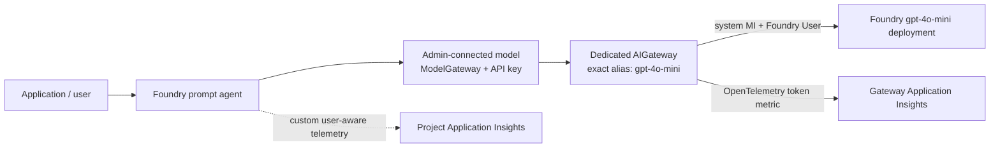
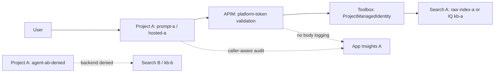
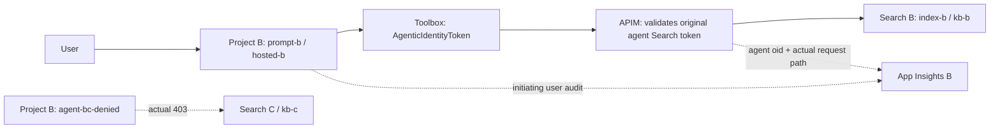
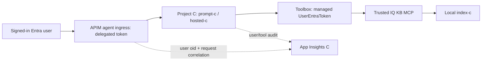

# Foundry agents, Toolbox and AI Gateway: the A/B/C identity lab

An isolated Microsoft Foundry lab demonstrating **project identity, agent identity and end-user identity**, real authorization denials, and caller-aware telemetry.

**Only the Foundry-agent setup is included here.** No LiteLLM gateway, unrelated gateway comparisons, old slide decks, tenant configuration, credentials, consent URLs, or raw customer/test conversations are included.

## Deployment options

| Path | Gateway | Foundry / network | Guide |
| --- | --- | --- | --- |
| Original Bicep + Python lab | Existing Standard v2; optional new Standard v2 template | Existing shared Foundry, public A/B/C Search and telemetry | [Bicep deployment below](#deploy) |
| **Modular Terraform: new gateways + shared Foundry** | **Dedicated `AIGateway` SKU**, zero/one/many | New shared account, optional projects/models and public ABC foundation | [Terraform guide](terraform/README.md) |
| **Modular Terraform: private Foundry only** | None required | New account with public access disabled; PE in an **existing VNet/subnet**, created or reused private DNS | [Private Foundry example](terraform/examples/private-foundry.tfvars.example) |
| Terraform: gateways + private Foundry | Dedicated `AIGateway` SKU | PE subnet plus a **separate existing delegated gateway backend subnet** | [Private composition example](terraform/examples/gateways-private-foundry.tfvars.example) |

The Terraform version is **new-resource infrastructure**. Mocked plans cover every composition, and a minimal public shared-Foundry + dedicated-gateway composition was also applied and exercised on October 15, 2026. That live proof covers the BYOM model path below; it does not claim the historical Standard v2 agent-policy flows or private-network variants already work on the dedicated tier. Modules can be called independently in your own stack. Foundry is PaaS: its **private-endpoint NIC**, not the account itself, is deployed into the subnet.

## TL;DR: results

| Scenario | Measured result |
| --- | --- |
| **A: project identity** | Prompt and hosted agents retrieve from Search A / IQ KB A using project-A credentials. APIM before Toolbox works. |
| **B: agent identity** | Prompt and hosted agents retrieve with their distinct agent identities. **Toolbox -> APIM -> Search/IQ** works; APIM JWT claims match the respective agent. |
| **C: user identity** | Prompt and hosted IQ retrieval works with managed **`UserEntraToken` / OBO**. **User -> APIM -> agent -> Toolbox -> IQ** preserves the working flow and gives APIM the initiating user's `oid`. |
| **AB / BC deny paths** | AB cannot query B; BC cannot query C. Assertions use actual backend authorization errors, not model-generated refusal text. |
| **Orchestrator in A** | Calling Prompt A succeeds. The tested Hosted A A2A target explicitly returns `HostedAgentNotSupported`. |
| **Confidential agent in B** | Question logged; answer returned to caller but absent from six telemetry tables in the corrected test window. `store:false` is enforced even when the caller asks for `store:true`. |
| **Telemetry isolation** | Three App Insights / Log Analytics pairs; no foreign-project custom events in the tested windows. |
| **Dedicated AI Gateway BYOM** | On October 15, a prompt agent using `aigw-admin-models/gpt-4o-mini` completed through an Admin-connected `ModelGateway` connection and dedicated `AIGateway`. Gateway monitoring attributed 63 tokens (57 input, 6 output) to the connection's runtime-key identity. |

**Boundaries:** separate Search **services**, not index isolation inside one shared KB; no two-human or document-ACL proof; C raw Search managed-user calls remain broker-rejected. The generic OAuth fallback is **optional and consent-gated**, not required by the working C IQ path. The BYOM gateway sees the connection key identity, not the initiating human user. No claim of zero provider/internal retention.

The results above are historical measured behavior, not a promise that a new subscription, region, API version or later service rollout behaves identically. This standalone extraction is checked with offline tests and Bicep compilation; publishing this repository does **not** redeploy or revalidate Azure resources.

## Which APIM / AI Gateway SKU does each version use?

**The original verified lab uses `StandardV2`, capacity 1. The new Terraform gateway module uses the dedicated `AIGateway` SKU.** The Bicep APIM template and original deployment wrapper intentionally remain Standard v2.

Two different concepts are easy to confuse:

| Term | Meaning | This lab |
| --- | --- | --- |
| **AI gateway capabilities in APIM** | Capabilities for model, agent, MCP and A2A traffic on API Management tiers; individual capabilities have tier-specific availability. | Uses MCP/HTTP APIs, Entra validation, XML policies, correlation and App Insights diagnostics on Standard v2. |
| **Dedicated AI Gateway tier (preview)** | A separate AI-focused offering with its own resource/runtime model, runtime access keys and policy experience. | **Terraform provisions it using `Microsoft.ApiManagement/aigateways` / `AIGateway`.** A public BYOM prompt-agent path is live-verified; the original policies, OBO flows and private modes are not assumed equivalent. |

The Terraform stack gives each new gateway identity the documented **Foundry User** backend role. Model import, alias assignment, MCP publication, runtime-key creation and telemetry destination setup remain explicit portal steps because the published ARM contract exposes the gateway resource but not those asset workflows. The repository then creates the Foundry Admin-connected model with [admin-model-connection.bicep](admin-model-connection.bicep). During preview, every runtime key can call **all** published models and tools in its gateway; this is not a per-user or per-asset authorization boundary. Use separate gateways when assets need authorization isolation.

There is no Foundry **model-inference gateway association** until you import a model and create the Admin-connected model. The historical Standard v2 APIs govern agent/tool/data hops; they do not automatically route all model calls through APIM or enable model token metering/caching.

### Live BYOM / Admin-connected model path

This uses Foundry Agent Service **Bring Your Own Model**. It does **not** enable Foundry's separate AI Gateway integration preview.



- Agent model reference: `<connection-name>/<gateway-model-alias>`, measured as `aigw-admin-models/gpt-4o-mini`.
- Gateway base URL: `https://<gateway>/default/models/openai/v1`.
- Gateway -> Foundry backend authentication: gateway system-managed identity with **Foundry User**.
- Agent Service -> gateway authentication: a dedicated gateway runtime key stored in the Foundry connection. The exposed test key was rotated before the passing test and is not in source or Terraform state.
- The dedicated gateway routes by **exact model alias**. Calling the backend deployment name before assigning the matching alias returned `model_not_found`.
- Configure the gateway telemetry destination **before** test traffic. In this preview, Application Insights received token metrics and caller-key identity; exported model logs/traces are not yet available, so the trace-backed call counter can remain zero.
- Custom agent/app telemetry is still required for initiating-user identity. Correlate it with a non-PII correlation ID; the shared runtime key does not propagate the human user's `oid`.
- The service returned `isSharedToAll: false` after a deployment requesting `true`. Same-project agent use passed; deploy one connection per project until cross-project sharing is revalidated.

The same Bicep template accepts `connectionCategory=ApiManagement` for an existing Standard v2 APIM model endpoint. That branch is provided but was not part of this dedicated-tier live test.

Official references, checked October 15, 2026:
[APIM AI gateway capabilities](https://learn.microsoft.com/azure/api-management/genai-gateway-capabilities) and
[dedicated AI Gateway tier overview](https://learn.microsoft.com/azure/api-management/ai-gateway-overview).

## Architecture schemas


Editable source: [Excalidraw diagram](docs/architecture.excalidraw). Regenerate both formats with `python docs\generate_diagrams.py`.

### A - Project identity



The Search credential is project A's MI. Agents can share that data access; merely creating separate agents does not make their data permissions distinct.

### B - Agent identity



APIM does not swap in its own Search identity or perform an OBO exchange on this path. Search enforces the original agent's permissions.

### C - End-user identity



**APIM is before the agent**, not between the agent and Toolbox. Toolbox obtains the downstream user token on its trusted first-party path. Project C and its agents receive no Search data grants.

## Resources and agents

The original Bicep foundation creates three new projects in an **existing Foundry account**, three isolated keyless Basic Search services, and three App Insights/workspace pairs. It reuses an existing **`gpt-4o-mini` deployment** and **Standard v2 APIM**. Terraform can instead create the shared Foundry and optional model/projects, compose new dedicated AI gateways, and optionally add the same ABC foundation.

| Project | Agents | Search data authorization |
| --- | --- | --- |
| `abc-a` | `prompt-a`, `hosted-a`, `agent-ab-denied`, `a-orchestrator` | Project A MI -> Search A only |
| `abc-b` | `prompt-b`, `hosted-b`, `b-confidential`, `agent-bc-denied` | Each B agent -> Search B only; not project B MI |
| `abc-c` | `prompt-c`, `hosted-c` | Signed-in user's permissions; no project/agent data-reader grant |

Each Search service contains `index-a/b/c`, local source `ks-a/b/c`, and `kb-a/b/c`. One source/index belongs to each KB. The signed-in provisioning user receives Search write permissions for seeding; that user is not a second-human deny test.

**The historical ABC agent lab is public-endpoint, not a production network-isolation baseline.** The new private Foundry Terraform mode provisions account PE/DNS in an existing VNet, but not the private dependencies/egress of a full hosted-agent lab. Running the relevant setup incurs Search, hosted-agent/model, gateway and telemetry charges.

## IaC and code map

| File | Responsibility |
| --- | --- |
| [infra.bicep](infra.bicep), [projects.bicep](projects.bicep) | Search services, projects/MIs, role assignments, three telemetry sinks; existing Foundry/APIM references |
| [apim.bicep](apim.bicep) | **Optional** creation of a new Standard v2 service; not the dedicated AI Gateway preview tier |
| [deploy.ps1](deploy.ps1) | Foundation deployment; discovers account location and APIM tier; retains runtime agent/tool state on redeployment |
| [setup.ps1](setup.ps1) | Sequential end-to-end primary setup using existing Foundry/model/APIM |
| [search_resources.py](search_resources.py), [provision.py](provision.py) | Index/source/KB schemas, deterministic synthetic fixtures, auth connections and Toolboxes |
| [publish_agents.py](publish_agents.py) | Agent versions, role grants, MCP relay APIs and explicit working default routes |
| [hosted/main.py](hosted/main.py) | MAF hosted runtime, tool calls, user audit, source activity, orchestration and confidential middleware |
| [configure_agent_gateway.py](configure_agent_gateway.py) | B's downstream APIM data gateway |
| [configure_user_ingress.py](configure_user_ingress.py) | C's user-facing agent APIM API |
| [policies/toolbox-proxy-policy.xml](policies/toolbox-proxy-policy.xml) | A's upstream Toolbox relay policy, with zero body logging |
| [verify.ps1](verify.ps1), [test_routes.py](test_routes.py), [verify_showcase.py](verify_showcase.py) | Actual route/marker/denial tests, identity correlation and privacy scans |
| [admin-model-connection.bicep](admin-model-connection.bicep), [smoke_admin_model_agent.py](smoke_admin_model_agent.py) | `ModelGateway` / `ApiManagement` Admin-connected model IaC and no-store prompt-agent smoke test |
| [terraform/](terraform/) | Composable shared-Foundry, dedicated AI Gateway and optional ABC modules; private-only or gateway/shared-account examples; mocked plan tests |

Raw Search uses a managed **OpenAPI-to-MCP adapter**, or B hosted REST tools, rather than an invented native index MCP URL. IQ uses the real KB MCP endpoint. For the tested native Azure AI Search tool, documented account-MI behavior is not assumed to be project/agent/user identity.

## Deploy

### Prerequisites

- **Windows + PowerShell**, Python 3.12, Azure CLI with Bicep, and Git. Hosted code targets Python 3.13. Local config locking uses Windows `msvcrt`.
- An existing Foundry account supporting projects, hosted agents, Toolbox and the preview Search/IQ APIs, with a `gpt-4o-mini` model deployment. The deployment name can differ; the model family here is fixed.
- An existing **Standard v2** APIM service, or explicitly create one using the optional template below.
- Resource deployment and role-assignment permissions on the lab RG, existing Foundry account/projects, and APIM configuration. Contributor alone cannot create RBAC assignments.
- The intended lab tenant/user signed into Azure CLI. Hosted-agent regional availability, quota and preview access are prerequisites, not bypassed by these scripts.

Choose an account without conflicting `abc-a/b/c` projects, or deliberately reuse this lab's resources. Do not attach the script to unrelated projects. Role mismatches in B/C fail explicitly instead of silently revoking existing grants.

```powershell
git clone https://github.com/yelghali/foundry-agents-toolbox-ai-gateway.git
Set-Location .\foundry-agents-toolbox-ai-gateway
python -m venv .venv
.\.venv\Scripts\Activate.ps1
python -m pip install -r requirements-dev.txt
az login --tenant "<tenant-id>"
az account set --subscription "<subscription-id>"

.\setup.ps1 `
  -SubscriptionId "<subscription-id>" `
  -FoundryResourceGroup "<existing-foundry-rg>" `
  -FoundryAccountName "<existing-foundry-account>" `
  -ApimResourceGroup "<existing-apim-rg>" `
  -ApimName "<existing-standard-v2-apim>" `
  -ResourceGroup "rg-foundry-agents-toolbox" `
  -SearchLocation "swedencentral" `
  -ModelDeployment "gpt-4o-mini"
```

No Azure resources are deployed by cloning or pushing this repository. `setup.ps1` is the explicit deployment action. It does not create the Foundry account/model or delete Azure resources. It reuses and modifies the named lab projects/APIs.

Optional **new, billable** Standard v2 APIM, before running setup:

```powershell
az group create --name "<new-apim-rg>" --location eastus2
az deployment group create --resource-group "<new-apim-rg>" `
  --template-file .\apim.bicep `
  --parameters apimName="<globally-unique-name>" `
    publisherEmail="<your-email>" publisherName="<your-team>"
```

The initial live lab used Foundry in East US 2 and Search in Sweden Central. These are historical working regions, not a guarantee of current subscription capacity.

### Incremental workflow

`deploy.ps1` creates the foundation only. Then provision **all three cohorts** before publishing the showcase agents:

```powershell
python .\provision.py
python .\publish_agents.py --cohort a --routes direct toolbox apim --showcase
python .\publish_agents.py --cohort b --routes direct toolbox --showcase
python .\publish_agents.py --cohort c --routes direct toolbox
python .\configure_agent_gateway.py
python .\publish_agents.py --cohort b --routes data-gateway
python .\configure_user_ingress.py
```

Default agent endpoints are pinned to A `apim`, B `data-gateway`, C `toolbox` once those routes exist. Publish sequentially within a cohort. Tool/agent publication creates versions; deployment alone is never treated as a passed retrieval test.

## Tests and observability

```powershell
# No Azure calls:
python -m unittest test_local -v
az bicep build --file .\infra.bicep
az bicep build --file .\apim.bicep
az bicep build --file .\admin-model-connection.bicep

# Live, authenticated, billable model/tool calls:
.\verify.ps1

# Live BYOM prompt-agent call after gateway onboarding and connection deployment:
python .\smoke_admin_model_agent.py `
  --subscription-id "<subscription-id>" `
  --project-endpoint "https://<account>.services.ai.azure.com/api/projects/<project>"

# Rerun after Azure Monitor ingestion delay:
python .\verify_showcase.py --privacy --store-request --audits --gateway --user-ingress
```

The offline suite covers forced no-store, malformed/stateless inputs, real backend error classification, consent URL handling, APIM update headers, config merging/Windows sharing retries, local schemas and portable dependencies. [CI](.github/workflows/validate.yml) runs offline checks only; it does not deploy resources or require Azure/GitHub secrets.

Live assertions check exact seeded markers, actual backend denial, version-pinned sessions, observed APIM principals and user correlation. The confidential scan covers `AppEvents`, `AppTraces`, `AppRequests`, `AppDependencies`, `AppExceptions` and `AppGenAIContent`, including dynamic properties. Ingestion can lag; missing evidence fails the check, not a success-shaped fallback.

In Azure: open the corresponding **App Insights -> Logs** or **Log Analytics -> Logs**. In Foundry: select the project, then **Observability -> Traces**. Custom `AppEvents` need not appear as native Foundry trace trajectories. See [log queries and privacy details](docs/observability.md).

Local `.config.json` contains telemetry settings and runtime state; `evidence/` can contain user queries and model outputs. Both are ignored. Terraform state, local tfvars and plans are also ignored and must be protected. The repository deliberately publishes the historical **results summary**, not the original tenant's runtime files or conversations.

Terraform validation runs separately in [CI](.github/workflows/validate.yml): formatting, locked provider initialization, schema validation and mocked plan tests. It does **not** apply resources or claim private-network/runtime compatibility. See [Terraform deployment modes, prerequisites and explicit tier boundaries](terraform/README.md).

## Limitations and negative findings

- **One KB exposing several indexes:** not proven to enforce per-index RBAC. Earlier index-only reader grants failed KB retrieve even for a single local source; these demonstrations isolate at Search-service scope.
- **Document-level security:** `x-ms-query-source-authorization` and ingestion-time permission metadata are separate preview controls; no document-ACL scenario is implemented/tested here.
- **C raw Search:** both OpenAPI and native Search managed-user probes were broker-rejected as untrusted destinations. C's verified path is IQ.
- **APIM in the wrong hop:** B APIM-before-Toolbox lost required agent context; C APIM-before-Toolbox managed OBO failed. The working placements above are deliberate.
- **APIM visibility:** actual request URL/path/principal can be logged at the hop it sees. APIM before a KB does **not** observe that KB's internal local-index subqueries.
- **Dedicated AI Gateway preview authorization:** runtime access keys are gateway-scoped and each key can call every published model and tool. Per-asset key scoping and the historical managed-user OBO behavior are not implemented or claimed.
- **Dedicated gateway observability:** gateway Application Insights currently exports model token metrics, including key identity and model/operation attributes. It does not make a shared key user-aware, and preview model logs/traces are not yet exported.
- **Admin-connected model sharing:** the live service normalized `isSharedToAll` to `false`; only same-project use was validated.
- **One human:** no two-human allow/deny proof. C's successful tests also checked the absence of project/agent Search data grants.
- **Confidentiality:** container flags alone initially leaked model content through Foundry server traces. The corrected confidential agent uses the direct model endpoint, question-only audit and enforced `store:false`. Older test traces remain. This is not a zero-provider-retention guarantee.
- **Hosted A2A:** the measured target returned `HostedAgentNotSupported`; the orchestrator preserves that actual platform result. Prompt-peer invocation passed.
- **Optional OAuth:** [configure_user_fallback.py](configure_user_fallback.py) adds separate Entra OAuth connections and a Toolbox/APIM comparison. It requires `azd`, application-registration permissions and fresh per-connection user consent. It has seven-day lab credentials and is **not part of setup**. The hosted consent continuation requires `--request-store`; never apply that bootstrap to the confidential agent. [open_user_consent.py](open_user_consent.py) validates client, scope, callback and expiry before opening the real consent URL.
- [configure_native_user_search.py](configure_native_user_search.py) preserves the separate failed native-user experiment; it is not enabled by default.

## References

- [Connect agents to Foundry IQ](https://learn.microsoft.com/azure/foundry/agents/how-to/foundry-iq-connect)
- [Hosted agent with IQ and Toolbox](https://learn.microsoft.com/azure/foundry/agents/quickstarts/quickstart-foundry-iq-hosted-agent)
- [Tool authentication and identities](https://learn.microsoft.com/azure/foundry/agents/how-to/tools/tool-authentication)
- [Foundry trace data handling](https://learn.microsoft.com/azure/foundry/observability/concepts/trace-data)
- [Sensitive trace content](https://learn.microsoft.com/azure/foundry/observability/how-to/traces-sensitive-content)
- [Model privacy and retention](https://learn.microsoft.com/azure/foundry/responsible-ai/openai/data-privacy)
- [Search document permission enforcement](https://learn.microsoft.com/azure/search/search-query-access-control-rbac-enforcement)
- [Manage dedicated AI Gateway models and tools](https://learn.microsoft.com/azure/api-management/ai-gateway-manage-models-tools)
- [Govern dedicated AI Gateway assets](https://learn.microsoft.com/azure/api-management/ai-gateway-govern-secure-assets)
- [Bring your own model to Foundry Agent Service](https://learn.microsoft.com/azure/foundry/agents/how-to/ai-gateway)
