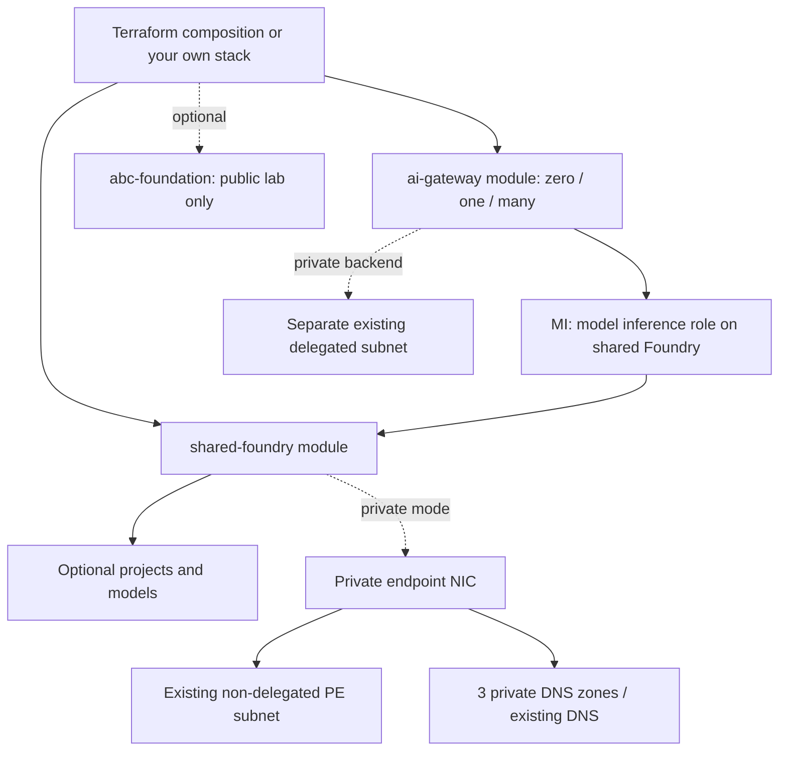

# Modular Terraform: shared Foundry and dedicated AI Gateways

This is a **new infrastructure deployment option**, not an in-place conversion of the earlier Bicep resources.

**Gateway SKU:** Terraform creates `Microsoft.ApiManagement/aigateways@2026-09-01-preview` with **`sku.name = "AIGateway"`**. It does not create a Standard v2 service or pretend that an arbitrary APIM `sku_name` switch migrates the original policies.

## Pick the setup

| Setup | Resources | Example variables |
| --- | --- | --- |
| New AI gateways + one shared Foundry | One shared account, optional projects/models, one or many independent AI gateways, per-gateway MI inference grant | [gateways-shared-foundry](examples/gateways-shared-foundry.tfvars.example) |
| Private Foundry only in an existing VNet | Foundry with public data-plane access disabled, one PE in your existing subnet, three DNS zones or reused zones/links; no gateways/Search/models by default | [private-foundry](examples/private-foundry.tfvars.example) |
| AI gateway + private Foundry | The private Foundry setup plus a gateway using a **separate existing delegated backend subnet** in the same VNet | [gateways-private-foundry](examples/gateways-private-foundry.tfvars.example) |
| Optional A/B/C lab | Adds the three projects, three keyless Search services, three App Insights/workspace pairs and matching role assignments | Set `enable_abc_lab = true`, a deployer object ID and a `gpt-4o-mini` deployment, on a **public** Foundry setup |

The top-level composition manages a **new resource group**. To deploy just a module into an existing resource group, call that module directly from your own stack. Never apply these new-resource declarations over the original environment without an intentional Terraform import/state migration.

## Reusable modules

| Module | Creates | Does not create |
| --- | --- | --- |
| [shared-foundry](modules/shared-foundry) | AIServices/S0 account with project management, optional projects/model deployments, optional PE/DNS | Gateways, VNets, subnets, Search, agent containers |
| [ai-gateway](modules/ai-gateway) | Dedicated AIGateway resource with MI, optional existing outbound subnet reference | Classic APIM service, XML policies, managed-user OBO equivalence, model/tool assets or runtime access keys |
| [abc-foundation](modules/abc-foundation) | Original public A/B/C Search/telemetry/role foundation and compatible nonsecret config output | Foundry account/projects, gateway, indexes/KBs, agents or user consent |



### Direct module example: private account only

From the repository root, inside your own initialized Terraform stack with the same AzAPI/AzureRM providers:

```hcl
module "private_foundry" {
  source              = "./terraform/modules/shared-foundry"
  name                = "your-unique-foundry"
  resource_group_id   = azurerm_resource_group.application.id
  resource_group_name = azurerm_resource_group.application.name
  location            = "eastus2"
  private_network = {
    virtual_network_id        = var.existing_vnet_id
    private_endpoint_subnet_id = var.existing_pe_subnet_id
  }
}
```

`projects` and `model_deployments` default to empty, so this deploys only the account and private access. A Foundry account is **PaaS, not injected into your subnet**: the PE NIC is in the subnet. Account inbound Private Link is not hosted-agent outbound VNet integration.

### Direct module example: another gateway sharing that account

```hcl
module "team_gateway" {
  source            = "./terraform/modules/ai-gateway"
  name              = "your-team-ai-gateway"
  resource_group_id = azurerm_resource_group.application.id
  location          = "eastus2"
  backend_subnet_id = var.existing_gateway_delegated_subnet_id
}

resource "azurerm_role_assignment" "gateway_inference" {
  scope                            = module.private_foundry.id
  role_definition_name             = "Cognitive Services OpenAI User"
  principal_id                     = module.team_gateway.principal_id
  skip_service_principal_aad_check = true
}
```

The root composition already creates that per-gateway grant. It does not give the gateway Search data access.

## Prerequisites and deployment

- Terraform **>=1.9**, tested with **1.16.5**; AzureRM **5.9.0** and AzAPI **2.13.0** are locked for Windows/Linux.
- An Azure login/identity with resource creation, RBAC assignment, and existing subnet/DNS permissions. Register `Microsoft.CognitiveServices`, `Microsoft.ApiManagement`, and `Microsoft.Network`; the ABC addon also needs Search, Insights and OperationalInsights. Providers are not auto-registered.
- Dedicated AI Gateway preview availability: **East US 2 or Sweden Central**, with applicable preview enrollment/quota. A model deployment also needs model/region quota.
- For private mode: an existing VNet and PE subnet, plus working private DNS resolution and a client/runner with a route to that VNet. The stack neither creates nor modifies the VNet, subnet delegation, NSGs, routes or custom DNS servers.
- Protect Terraform state with an encrypted remote backend and restricted RBAC. State can contain provider-returned sensitive resource attributes even though outputs omit runtime keys. State, local tfvars and saved plans are git-ignored.

```powershell
az login --tenant "<tenant-id>"
az account set --subscription "<subscription-id>"
Set-Location .\terraform
Copy-Item .\examples\private-foundry.tfvars.example .\terraform.tfvars
# Edit subscription, names and existing VNet/subnet IDs.
terraform init
terraform plan -out=deployment.tfplan
terraform apply deployment.tfplan
```

For new gateways/shared Foundry, copy the corresponding example instead. **Nothing has been applied to Azure merely by publishing these files.** Terraform apply is billable; no apply/destroy runs in CI. Use a separate backend/state per deployment rather than changing identities/names in an existing state.

The PE is created in the **VNet's location**, which may differ from the Foundry account's region. The private setup disables public access from account creation, rather than opening it temporarily for provisioning.

### Existing private DNS

Default private mode creates and links:

- `privatelink.cognitiveservices.azure.com`
- `privatelink.openai.azure.com`
- `privatelink.services.ai.azure.com`

To reuse central DNS, provide **all three full zone IDs**, keyed by those exact names. If the zones are already linked to the VNet, set `create_dns_vnet_links = false`; this avoids duplicate-link conflicts. If links are not present, leave it true and grant link-write permission on the existing zone scopes. With custom/on-premises DNS, configure forwarding to Azure DNS/Private Resolver separately.

### Gateway outbound subnet: pinned API contract

The checked public ARM schema for **`2026-09-01-preview`** specifies a same-region subnet delegated to **`Microsoft.App/environments`**, with `properties.backend.subnet.id` set at creation. The module checks that delegation and region and forces gateway replacement if the subnet changes.

Some portal networking documentation currently describes a `Microsoft.Web/serverFarms` subnet/update flow. These are **not silently treated as equivalent**. This module follows the linked pinned ARM contract; confirm that API/preview is enabled for your subscription. It fails for the other delegation and never changes an existing subnet to make the check pass. Network sizing, required NSG/UDR egress and subnet capacity still need Azure-side validation.

The backend subnet enables **outbound** access to private Foundry. This module does not provision a gateway **inbound private endpoint**, so do not interpret it as a fully private gateway frontend.

## What “similar setup” does and does not mean

The Foundry/project/model and optional ABC foundation are analogous to the Bicep setup. The dedicated AI Gateway tier has a **different management/runtime surface** from the Standard v2 XML/MCP APIs tested in the historical lab.

- Terraform provisions the new gateway(s) and their MI inference permission.
- Use the AI Gateway portal's **managed-identity** model import/onboarding flow for the shared account; local Foundry keys are disabled. This repository does not invent undocumented Terraform model/tool-asset APIs or export runtime access keys.
- It does **not** claim the earlier Standard v2 APIM placements, identity passthrough, user correlation, or confidentiality tests have passed on the new tier.
- Existing `apim.bicep` / `setup.ps1` intentionally remain the original **Standard v2** path.
- Python direct/Toolbox agent publication can now run **without any classic APIM**. Classic policy routes fail explicitly if given a dedicated gateway ID.
- Private Foundry-only secures **account ingress**. It does not provision private Storage, Search, Cosmos, ACR, Azure Monitor Private Link Scope, or hosted-agent subnet integration. Do not run the old public ABC lab behind a disabled account endpoint and assume those dependencies are private.

## Optional ABC foundation and Python publishing

In the public gateways/shared Foundry example, enable:

```hcl
enable_abc_lab     = true
deployer_object_id = "<your-user-or-service-principal-object-id>"
model_deployments = {
  "gpt-4o-mini" = {
    model_name    = "gpt-4o-mini"
    model_version = "2024-07-18"
  }
}
```

Then apply and export:

```powershell
.\export_config.ps1
Set-Location ..
python .\provision.py
python .\publish_agents.py --cohort a --routes direct toolbox --showcase
python .\publish_agents.py --cohort b --routes direct toolbox --showcase
python .\publish_agents.py --cohort c --routes direct toolbox
```

The exporter refuses to overwrite an existing runtime config. Runtime provisioning/seeding and hosted-agent publication are deliberate Python SDK steps, not Terraform provisioner side effects. Only project A gets a project-MI Search reader grant; B agent grants are assigned after publication; C remains user-authorized.

To reproduce the original **Standard v2** gateway policy routes as well, explicitly set `existing_standard_apim_resource_id` to an existing `Microsoft.ApiManagement/service/...` ID. The addon reads and checks its actual `StandardV2` SKU. Dedicated `.../aigateways/...` IDs are not accepted as that bridge. No new Standard v2 resource is created by Terraform.

## Verification

```powershell
terraform fmt -check -recursive
terraform init -backend=false -input=false -lockfile=readonly
terraform validate
terraform test -no-color
```

Tests use **mocked providers and plan assertions**: no credentials, Azure API calls, resources or teardown in Azure. They cover the real AIGateway type/SKU, multiple gateways, public/private Foundry-only, reuse of DNS, same-VNet constraints, wrong delegation/region, missing ABC model, and absence of B/C project data grants. Validation is not a successful Azure deployment or runtime OBO test.

After a real private apply, from a VNet-connected host resolve all three account hostnames to private IPs, test Entra-authenticated data-plane access, and confirm an external client cannot use the account. For a gateway, also validate MI model import and private backend reachability before routing applications through it.

## Sources

- [Dedicated AI Gateway create schema (pinned public ARM example)](https://github.com/Azure/azure-rest-api-specs/blob/ee4ba4c11aa237b364d1c42a2d623bb880e8c5a4/specification/apimanagement/resource-manager/Microsoft.ApiManagement/AIGateway/examples/2026-09-01-preview/AiGatewayCreate.json)
- [Dedicated AI Gateway subnet/create-only schema](https://github.com/Azure/azure-rest-api-specs/blob/ee4ba4c11aa237b364d1c42a2d623bb880e8c5a4/specification/apimanagement/resource-manager/Microsoft.ApiManagement/AIGateway/AIGateway.tsp)
- [AI Gateway overview](https://learn.microsoft.com/azure/api-management/ai-gateway-overview) and [networking](https://learn.microsoft.com/azure/api-management/ai-gateway-configure-private-networking)
- [Foundry account ARM schema](https://learn.microsoft.com/azure/templates/microsoft.cognitiveservices/2025-06-01/accounts)
- [Foundry private networking](https://learn.microsoft.com/azure/foundry/how-to/configure-private-link) and [private DNS zones](https://learn.microsoft.com/azure/private-link/private-endpoint-dns)
