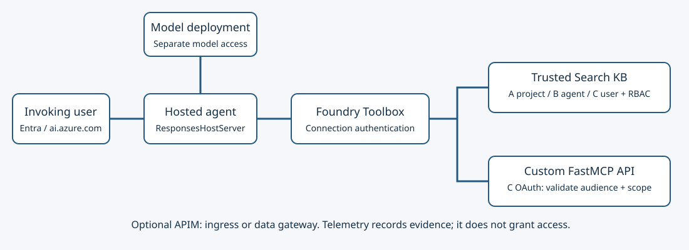
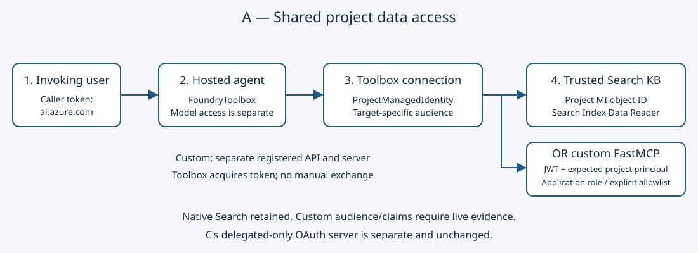
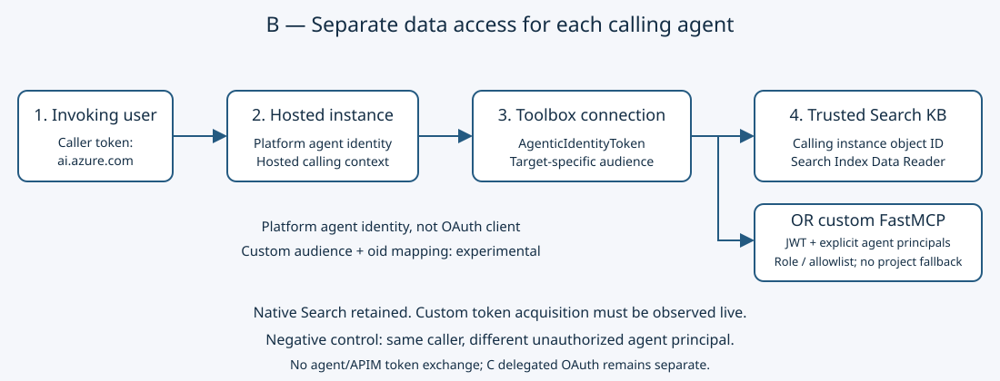
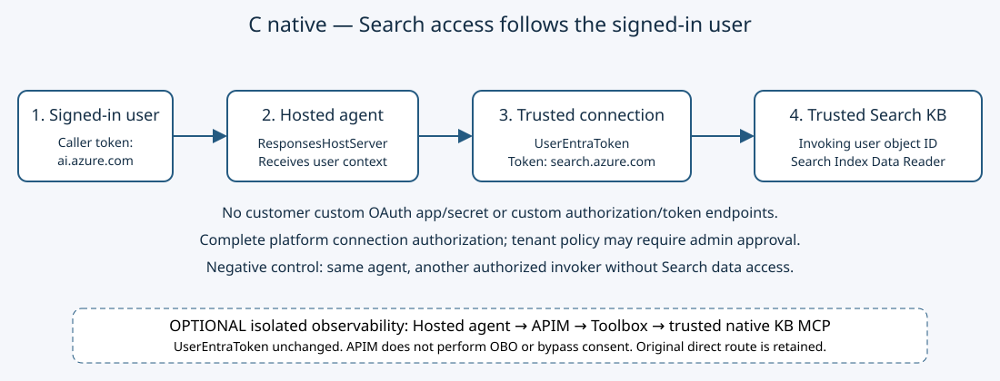
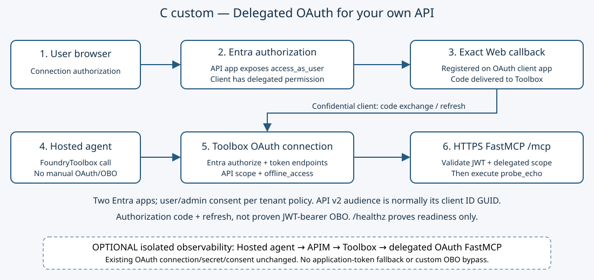

# Welcome: choose the identity your workload needs

Deploy **one** hosted agent; prove **who can access its tools** with an allow and a deny.
Clone the [repository](https://github.com/yelghali/foundry-agents-toolbox-ai-gateway)
to execute commands locally. MOAW is the reading experience, not a terminal.
Each sample is independently copyable and does not import the root lab.

## Choose one independent track

| Need | Track | Data principal | Time after setup |
| --- | --- | --- | --- |
| Shared native KB or custom API access across a project | A | Project managed identity | 45 minutes |
| Separate native KB or custom API access for each agent | B | Calling agent instance identity | 60 minutes |
| Search access follows the signed-in user | C native | User via managed `UserEntraToken` | 60 minutes |
| Custom API with delegated OAuth scopes | C custom | User authorizing the OAuth connection | 75 minutes |

- Alternatives, **not sequential exercises**. C custom needs no Search KB.
- A and B each offer **native Azure Search KB MCP** and **custom FastMCP** targets.
  The custom target is an application/agent-token API, not C's delegated OAuth server.
  Custom A/B connection configuration and local JWT tests do not by themselves
  establish live Toolbox custom-audience acquisition; require downstream token evidence.
- Budget 60–90 minutes for setup/evidence/cleanup, plus deployment/RBAC propagation.
  The 150-minute estimate covers one track.
- Reuse compatible infrastructure or choose optional foundation replay.
- Learn to separate caller, runtime, connection and data identities; invoke an
  Active pinned version and capture genuine tool allow/deny evidence.

**Before deploying:** write your track, expected principal, token audience and negative test.

---

# Architecture: where authorization actually happens



- Caller: Entra token for `https://ai.azure.com/.default`.
- Hosted runtime: `FoundryChatClient` + `FoundryToolbox`;
  `ResponsesHostServer` supplies hosted context.
- Connection: selects downstream authentication. Provisioning ARM token **≠ data token**.
- Search/API: validates downstream token and permissions. APIM cannot replace this boundary.

| Track | Connection authentication | Downstream audience | Authorization |
| --- | --- | --- | --- |
| A | `ProjectManagedIdentity` | `https://search.azure.com` | Project MI Search RBAC |
| B | `AgenticIdentityToken` | `https://search.azure.com` | Calling instance Search RBAC |
| A custom | `ProjectManagedIdentity` | Registered custom API audience | Validated project principal + role or explicit allowlist |
| B custom | `AgenticIdentityToken` | Registered custom API audience | Validated agent principal + role or explicit allowlist; experimental until observed |
| C native | `UserEntraToken` | `https://search.azure.com` | User Search RBAC |
| C custom | OAuth2 authorization code + refresh | Custom API v2 audience | JWT validation + delegated scope |

**Native ≠ custom OAuth:** native uses platform-managed user context; custom uses
authorization code and `offline_access`. Neither sample captures JWT-bearer OBO.
A user `oid` proves delegated identity, not grant type.
For A/B custom, Toolbox must acquire the API token itself. The agent and APIM
must not exchange tokens. An ARM connection accepting `audience` is not proof
that the hosted identity can acquire that audience.

[Full architecture](https://github.com/yelghali/foundry-agents-toolbox-ai-gateway/blob/main/docs/architecture.svg)
adds optional prompt-agent, raw Search and gateway paths.

**Boundary check:** why does granting the invoking developer Search access not fix B?

---

# Prerequisites, permissions and safety

## Required before deployment

- Dedicated learning resources in your own tenant/subscription; synthetic data only.
- Windows, PowerShell, Git, Azure CLI/Bicep; Python 3.12 for root tooling,
  Python 3.13 for hosted sample builds.
- Foundry account/project, existing chat deployment (default `gpt-4o-mini`),
  hosted-agent/Toolbox preview access and sufficient regional quota.
- Optional Bicep replay: existing **APIM Standard v2**; `deploy.ps1` rejects other SKUs.
  Dedicated `AIGateway` is a separate optional Terraform/portal path.
- A/B custom: a separately registered Entra API, HTTPS-reachable application-token
  FastMCP server, and permission to authorize the intended project/agent principal.
  Do not configure the C delegated-only deployment to accept application tokens.
- C custom: Azure Developer CLI supporting `azd ai connection create`,
  two Entra registrations and an HTTPS-reachable FastMCP host.
- No account? Use approved Azure provisioning or the
  [Terraform guide](https://github.com/yelghali/foundry-agents-toolbox-ai-gateway/blob/main/terraform/README.md).
  Decide resource ownership before mixing Terraform and Bicep.

## Permission owners

| Owner | Required authority |
| --- | --- |
| Infrastructure deployer | Resource deployment in lab/Foundry groups; RBAC assignment write at affected scopes (e.g. Contributor + scoped RBAC Administrator) |
| Project administrator/provisioner | Connection write, Toolbox create/update; invoker Azure AI User/project-agent access; runtime model/Toolbox access |
| Search RBAC administrator | Search Index Data Reader for the selected A/B/native data object ID |
| Entra application administrator/developer | Custom API/client registration, permissions and required tenant consent/assignment |
| Intended user | Tenant sign-in policy and any connection authorization |

**Project access ≠ data access.** Subscription ownership does not grant Entra app
permissions. Use actual Entra object IDs, not ARM IDs/client IDs/agent names.
Provisioners create connections/Toolboxes only: no apps, consent, roles or hosted deployment.
B requires a supported platform calling identity; tenant/preview admins may need to enable it.

## Costs and secrets

- Replay creates **three Basic Search services**, three projects and three telemetry
  pairs even for one track. Budget for Search, tokens, hosting, APIM and log ingestion;
  no fixed price/free tier is promised.
- Never commit `.config.json`, secrets, tokens, runtime keys or live evidence.
- C custom uses interactive secret entry. azd passes the secret in child-process
  arguments: trusted workstation only, no debug output, rotate afterward.
- Validated claims/logs are sensitive. `store=false` does not guarantee no diagnostic
  logging or zero provider retention.

**Checkpoint:** confirm tenant/subscription, quota, permission scopes and cleanup ownership.
Unavailable preview? Inspect offline; do not report a live authorization success.

---

# Deploy the shared foundation

## Choose your setup

- **Own infrastructure:** Foundry project/model/hosted runtime. Native A/B/C also need
  a synthetic Search index, knowledge source and trusted KB. Record project endpoint/ARM ID,
  Search ARM ID, KB MCP URL and marker. Custom A/B instead need their registered API,
  application-token HTTPS server and exact expected principal IDs; C custom needs
  its separate delegated OAuth apps/HTTPS API.
- **Optional repository replay below:** creates all three cohorts in reviewed resources.
  APIM, `.config.json` and root `provision.py` are **not** standalone prerequisites.
- Clone/install/sign in; verify the displayed tenant/subscription:

```powershell
git clone https://github.com/yelghali/foundry-agents-toolbox-ai-gateway.git
Set-Location .\foundry-agents-toolbox-ai-gateway
python -m venv .venv
.\.venv\Scripts\Activate.ps1
python -m pip install -r .\requirements-dev.txt
az login --tenant "<tenant-id>"
az account set --subscription "<subscription-id>"
az account show --query "{tenant:tenantId,subscription:id,name:name}" -o json
```

- Pick a new lab group; fixed `abc-a/b/c` project names must not collide.
  Review [infra.bicep](https://github.com/yelghali/foundry-agents-toolbox-ai-gateway/blob/main/infra.bicep)
  and [projects.bicep](https://github.com/yelghali/foundry-agents-toolbox-ai-gateway/blob/main/projects.bicep):

```powershell
.\deploy.ps1 `
  -SubscriptionId "<subscription-id>" `
  -FoundryResourceGroup "<foundry-rg>" `
  -FoundryAccountName "<foundry-account>" `
  -ApimResourceGroup "<apim-rg>" `
  -ApimName "<standard-v2-apim>" `
  -ResourceGroup "rg-foundry-identity-workshop" `
  -SearchLocation "swedencentral" `
  -ModelDeployment "gpt-4o-mini"
```

- Requires existing Foundry/APIM/model; does not deploy a model.
  Writes `.config.json`. Projects/roles live in the **existing Foundry account**;
  Search/telemetry live in the new group.
- Seed only your A/B/native cohort; creates index/marker/source/KB/root tools and
  `evidence\foundation.json`. **B/C remove an existing project Search reader role**:
  never run on a shared project.

```powershell
python .\provision.py --cohort a # choose a, b or c
$config = Get-Content .\.config.json -Raw | ConvertFrom-Json
$cohort = $config.cohorts | Where-Object label -eq "a" # match selected cohort
$cohort.project | Format-List
$cohort | Select-Object searchId, searchEndpoint, knowledgeBaseName, marker
```

- Build the KB MCP URL using your sample README's format; retain the marker locally.
- **Do not run `setup.ps1` for one track:** it provisions all cohorts/agents/gateway routes.
- Checkpoint: locate project/KB/marker, then jump to your track. Deployment ≠ authorization proof.

## Publish only the selected hosted sample

- After that track's provisioner, activate its venv and work **inside its sample folder**.
- Set deployment values; local variables are not automatically forwarded remotely:

```powershell
$env:TOOLBOX_ENDPOINT = "<endpoint printed by selected provisioner>"
$env:AZURE_AI_MODEL_DEPLOYMENT_NAME = "<existing chat deployment>"
$env:AGENT_NAME = "<new hosted agent name>"
```

- Save this as `publish_hosted.py` there; run `python .\publish_hosted.py`.
  Same API as the [root publisher](https://github.com/yelghali/foundry-agents-toolbox-ai-gateway/blob/main/publish_agents.py),
  but packages **only** the selected sample, not the root multi-agent lab:

```python
import io
import os
import zipfile
from pathlib import Path
from azure.ai.projects import AIProjectClient
from azure.ai.projects.models import (
    CodeConfiguration, HostedAgentDefinition, ProtocolVersionRecord,
)
from azure.identity import AzureCliCredential

source = Path(__file__).resolve().parent
with io.BytesIO() as archive:
    with zipfile.ZipFile(archive, "w", zipfile.ZIP_DEFLATED) as bundle:
        for filename in ("hosted_agent.py", "requirements.txt"):
            bundle.write(source / filename, filename)
    archive.seek(0)
    credential = AzureCliCredential(tenant_id=os.environ["AZURE_TENANT_ID"])
    with AIProjectClient(
        endpoint=os.environ["FOUNDRY_PROJECT_ENDPOINT"], credential=credential,
    ) as project:
        version = project.agents.create_version_from_code(
            agent_name=os.environ["AGENT_NAME"], code=archive,
            definition=HostedAgentDefinition(
                cpu="0.5", memory="1Gi",
                code_configuration=CodeConfiguration(
                    runtime="python_3_13",
                    entry_point=["python", "hosted_agent.py"],
                    dependency_resolution="remote_build",
                ),
                protocol_versions=[
                    ProtocolVersionRecord(protocol="responses", version="2.0.0"),
                ],
                environment_variables={
                    key: os.environ[key] for key in (
                        "FOUNDRY_PROJECT_ENDPOINT",
                        "AZURE_AI_MODEL_DEPLOYMENT_NAME", "TOOLBOX_ENDPOINT",
                    )
                },
            ),
        )
        print("Agent version:", version.version)
        print("Deployment status:", version.status)
```

- Foundry **Agents → selected version**: inspect build/start diagnostics; wait for **Active**.
  A version number is not readiness. Pin it as `AGENT_VERSION`.
- **Identity**: obtain the actual calling instance object ID; project admin grants
  runtime project/model/Toolbox access (lab publisher uses project-scoped Azure AI User).
  B additionally needs that instance's Search role. Never substitute another MI.
- Preview differs? Follow the
  [official hosting workflow](https://learn.microsoft.com/azure/foundry/agents/quickstarts/quickstart-foundry-iq-hosted-agent).
  Its `azd deploy` needs its own manifests, absent from these bare samples.
  An existing correctly configured Active version may skip publishing.

---

# A: project managed identity



The hosted agent calls Toolbox; `ProjectManagedIdentity` selects the project identity.
Choose native Search KB MCP or custom FastMCP. The downstream service, not the
invoking developer, validates and authorizes retrieval.

<details>
<summary>Deploy A: prerequisites, roles and commands</summary>

## Prerequisites / registration

- Shared project data privileges are intentional. The commands below deploy the
  unchanged native target; for custom FastMCP follow the separate target setup in
  [A's runbook](https://github.com/yelghali/foundry-agents-toolbox-ai-gateway/blob/main/samples/project-identity/README.md).
- Resource owner enables project MI; Search admin grants **project MI object ID**
  Search Index Data Reader. Replay A already grants it: verify, do not broaden.
- Project admin grants invoker/runtime access. **No custom OAuth apps, secret,
  callback or per-user downstream OAuth consent**; tenant sign-in policies still apply.
  This statement applies to native Search: custom A requires an API registration,
  but no delegated OAuth client, callback or manual agent token exchange.

## Deployment checklist

- From clone root, install/configure/provision with fresh names:

```powershell
Set-Location .\samples\project-identity
python -m venv .venv
.\.venv\Scripts\Activate.ps1
python -m pip install -r .\requirements.txt
az login --tenant "<tenant-id>"
$env:AZURE_TENANT_ID = "<tenant-id>"
$env:FOUNDRY_PROJECT_ENDPOINT = "https://<account>.services.ai.azure.com/api/projects/<project>"
$env:FOUNDRY_PROJECT_RESOURCE_ID = "/subscriptions/<sub>/resourceGroups/<rg>/providers/Microsoft.CognitiveServices/accounts/<account>/projects/<project>"
$env:MCP_SERVER_URL = "https://<search>.search.windows.net/knowledgebases/<kb>/mcp?api-version=2026-05-01-preview"
$env:CONNECTION_NAME = "my-project-kb"
$env:TOOLBOX_NAME = "my-project-tools"
python .\provision_toolbox.py
```

- Search admin assigns the verified object ID:

```powershell
$env:SEARCH_RESOURCE_ID = "/subscriptions/<sub>/resourceGroups/<rg>/providers/Microsoft.Search/searchServices/<search>"
$env:DATA_PRINCIPAL_OBJECT_ID = "<project-managed-identity-object-id>"
az role assignment create --assignee-object-id $env:DATA_PRINCIPAL_OBJECT_ID --assignee-principal-type ServicePrincipal --role "Search Index Data Reader" --scope $env:SEARCH_RESOURCE_ID
```

- Use **Publish only the selected hosted sample** above; wait for Active, then invoke:

```powershell
$env:AGENT_NAME = "<hosted-agent-name>"
$env:AGENT_VERSION = "<active-version>"
$env:QUESTION = "Use the knowledge-base retrieval tool to find <synthetic test document>."
$env:EXPECTED_TEXT = "<known marker>"
python .\invoke_hosted.py
```

</details>

## Agent code → Toolbox

Hosted environment only for this identity test. Complete
[A runbook/scripts](https://github.com/yelghali/foundry-agents-toolbox-ai-gateway/blob/main/samples/project-identity/README.md).
The provisioner selects `ProjectManagedIdentity`; the agent does not acquire Search tokens manually.

```python
import asyncio
import os
from agent_framework import Agent
from agent_framework.foundry import FoundryChatClient
from agent_framework_foundry_hosting import FoundryToolbox, ResponsesHostServer
from azure.identity import DefaultAzureCredential

async def main():
    credential = DefaultAzureCredential()
    agent = Agent(
        client=FoundryChatClient(
            project_endpoint=os.environ["FOUNDRY_PROJECT_ENDPOINT"],
            model=os.environ["AZURE_AI_MODEL_DEPLOYMENT_NAME"],
            credential=credential,
        ),
        tools=FoundryToolbox(
            credential, name="retrieval", url=os.environ["TOOLBOX_ENDPOINT"],
        ),
        instructions="Return actual requested Toolbox results/errors; never invent markers or identities.",
        default_options={"store": False},
    )
    await ResponsesHostServer(agent).run_async()

if __name__ == "__main__":
    asyncio.run(main())
```

Input: project/model and Toolbox endpoint. Output: a hosted Responses agent; the runtime does not acquire a Search token.

## Toolbox configuration → Search connection

This excerpt from [the A provisioner](https://github.com/yelghali/foundry-agents-toolbox-ai-gateway/blob/main/samples/project-identity/provision_toolbox.py)
defines the ARM connection payload and its Toolbox tool; the complete script submits both.

```python
import os
from azure.ai.projects.models import MCPToolboxTool

target = os.environ["MCP_SERVER_URL"]
project_id = os.environ["FOUNDRY_PROJECT_RESOURCE_ID"].rstrip("/")
connection_id = f"{project_id}/connections/{os.environ['CONNECTION_NAME']}"
connection_payload = {"properties": {
    "category": "RemoteTool", "authType": "ProjectManagedIdentity",
    "target": target, "audience": "https://search.azure.com",
    "isSharedToAll": False, "metadata": {"ApiType": "Azure"},
}}
tool = MCPToolboxTool(
    name="retrieve", server_label="knowledge", server_url=target,
    project_connection_id=connection_id, require_approval="never",
)
```

Input: KB URL and project connection ID. Output: a connection-authenticated tool, not an agent-side `MCPTool`.

## Service-provided MCP contract

For the native choice, no custom server is required. Search supplies the trusted KB endpoint:

```text
https://<search>.search.windows.net/knowledgebases/<kb>/mcp?api-version=2026-05-01-preview
Agent request: retrieve <synthetic test document> using the advertised retrieval tool
Tool input/output schema: discover from this KB's MCP tools/list, not a guessed signature
Result: actual retrieval content containing <known marker>, or authorization failure
```

## Custom FastMCP alternative → application-token API

Keep the hosted code above unchanged and use a **fresh custom-target connection
and Toolbox**. The selected A connection remains `ProjectManagedIdentity`; its
target becomes the HTTPS API's `/mcp` URL and its audience must match the registered
API's actual token audience. Do not assume the Search audience works for this API.

In the copied A folder, start `python .\custom_server.py` with
`AZURE_TENANT_ID`, `CUSTOM_MCP_AUDIENCE` (the v2 API client-ID GUID), and
`CUSTOM_MCP_EXPECTED_PRINCIPAL_IDS` (only the project MI object ID).
Expose its `/mcp` over HTTPS. In the provisioner's shell set
`CUSTOM_MCP_SERVER_URL`, the same `CUSTOM_MCP_AUDIENCE`, and fresh
`CONNECTION_NAME`/`TOOLBOX_NAME`; run `python .\provision_custom_toolbox.py`.
Use its printed endpoint for a separate hosted version. API registration and
ACL-only application access prerequisites are in the complete sample below.

```python
# Custom target connection shape, not an agent-side token exchange.
custom_connection_payload = {"properties": {
    "category": "RemoteTool", "authType": "ProjectManagedIdentity",
    "target": os.environ["CUSTOM_MCP_SERVER_URL"],
    "audience": os.environ["CUSTOM_MCP_AUDIENCE"],
    "isSharedToAll": False, "metadata": {"ApiType": "Azure"},
}}
```

The [complete A sample](https://github.com/yelghali/foundry-agents-toolbox-ai-gateway/blob/main/samples/project-identity/README.md)
provides custom provisioning and server setup. The separate application-token
server validates JWT signature, tenant issuer, exact audience and expiry before
authorization. It requires the expected project principal, and a configured
application role or explicit principal allowlist; it must reject delegated-user
tokens. Call `identity_probe(experiment_id="<synthetic UUID>")`; the tool returns
`CUSTOM_MCP_APPLICATION_VALIDATED` and safe validated identifier claims, not JWTs
or arbitrary queries. Logging is disabled by default; protect any captured results.

**Custom proof:** request the advertised tool with a known marker, then use a
different non-authorized project. Require a backend allow/deny and validated
principal evidence. Local signed-token tests are not live Toolbox evidence.

**One proof exercise:** retrieve the marker, then use a fresh connection to a separate
test KB where the project MI lacks access. Require actual tool authorization denial,
not model text. Correlate Active version/time, role scope and backend audit where available.
A second authorized caller must not change the data principal. Never remove shared roles;
label configuration inference separately from captured identity evidence. Continue to cleanup.

---

# B: calling agent identity



The same agent-to-Toolbox integration now uses `AgenticIdentityToken` on the connection.
Search must authorize the calling instance, not the project MI.

<details>
<summary>Deploy B: prerequisites, calling identity, roles and commands</summary>

## Prerequisites / registration

- Separate agent data privileges; choose native Search KB or custom FastMCP.
  The commands below retain the native deployment. Custom target setup is separate in
  [B's runbook](https://github.com/yelghali/foundry-agents-toolbox-ai-gateway/blob/main/samples/agent-identity/README.md).
- Platform identity workflow creates/configures blueprint + calling instance,
  **not a manually registered confidential OAuth client**.
- Project admin grants invoker/runtime access; Search admin grants **calling instance
  object ID**, not blueprint/client ID/version, Search Index Data Reader.
- No custom OAuth secret/callback/per-user downstream consent. Tenant/preview admin
  may need to enable identity creation; local execution is not an equivalent test.
  Custom B does need a separately registered API and authorized agent principals.

## Deployment checklist

- From clone root, install/configure/provision:

```powershell
Set-Location .\samples\agent-identity
python -m venv .venv
.\.venv\Scripts\Activate.ps1
python -m pip install -r .\requirements.txt
az login --tenant "<tenant-id>"
$env:AZURE_TENANT_ID = "<tenant-id>"
$env:FOUNDRY_PROJECT_ENDPOINT = "https://<account>.services.ai.azure.com/api/projects/<project>"
$env:FOUNDRY_PROJECT_RESOURCE_ID = "/subscriptions/<sub>/resourceGroups/<rg>/providers/Microsoft.CognitiveServices/accounts/<account>/projects/<project>"
$env:MCP_SERVER_URL = "https://<search>.search.windows.net/knowledgebases/<kb>/mcp?api-version=2026-05-01-preview"
$env:CONNECTION_NAME = "my-agent-kb"
$env:TOOLBOX_NAME = "my-agent-tools"
python .\provision_toolbox.py
```

- Use shared **Publish only the selected hosted sample**; configure supported
  calling identity in Foundry **Agents → agent → Identity** and obtain its object ID.
- Search admin assigns it; allow RBAC propagation and wait for Active:

```powershell
$env:SEARCH_RESOURCE_ID = "/subscriptions/<sub>/resourceGroups/<rg>/providers/Microsoft.Search/searchServices/<search>"
$env:DATA_PRINCIPAL_OBJECT_ID = "<calling-agent-instance-object-id>"
az role assignment create --assignee-object-id $env:DATA_PRINCIPAL_OBJECT_ID --assignee-principal-type ServicePrincipal --role "Search Index Data Reader" --scope $env:SEARCH_RESOURCE_ID
$env:AGENT_NAME = "<hosted-agent-name>"
$env:AGENT_VERSION = "<active-version>"
$env:QUESTION = "Use the knowledge-base retrieval tool to find <synthetic test document>."
$env:EXPECTED_TEXT = "<known marker>"
python .\invoke_hosted.py
```

## Connection code

</details>

## Agent code → Toolbox

Inside [B's hosted `main()`](https://github.com/yelghali/foundry-agents-toolbox-ai-gateway/blob/main/samples/agent-identity/hosted_agent.py), the authenticated client and tool share a runtime credential.
Input: runtime credential and environment; output: the hosted agent's Toolbox tool.

```python
import os
from agent_framework import Agent
from agent_framework.foundry import FoundryChatClient
from agent_framework_foundry_hosting import FoundryToolbox, ResponsesHostServer
from azure.identity import DefaultAzureCredential

async def main():
    credential = DefaultAzureCredential()
    agent = Agent(
        client=FoundryChatClient(
            project_endpoint=os.environ["FOUNDRY_PROJECT_ENDPOINT"],
            model=os.environ["AZURE_AI_MODEL_DEPLOYMENT_NAME"], credential=credential,
        ),
        tools=FoundryToolbox(credential, name="retrieval", url=os.environ["TOOLBOX_ENDPOINT"]),
        instructions="Return actual requested Toolbox results/errors; never invent markers or identities.",
        default_options={"store": False},
    )
    await ResponsesHostServer(agent).run_async()
```

## Toolbox configuration → calling-instance connection

Payload/tool shape only; the complete
[B provisioner](https://github.com/yelghali/foundry-agents-toolbox-ai-gateway/blob/main/samples/agent-identity/provision_toolbox.py)
submits ARM PUT and Toolbox create/update.
[B runbook](https://github.com/yelghali/foundry-agents-toolbox-ai-gateway/blob/main/samples/agent-identity/README.md)
contains complete hosted/invocation scripts.

```python
import os
from azure.ai.projects.models import MCPToolboxTool

target = os.environ["MCP_SERVER_URL"]
project_id = os.environ["FOUNDRY_PROJECT_RESOURCE_ID"].rstrip("/")
connection_id = f"{project_id}/connections/{os.environ['CONNECTION_NAME']}"
connection_payload = {"properties": {
    "category": "RemoteTool", "authType": "AgenticIdentityToken",
    "target": target, "audience": "https://search.azure.com",
    "isSharedToAll": False, "metadata": {"ApiType": "Azure"},
}}
tool = MCPToolboxTool(
    name="retrieve", server_label="knowledge", server_url=target,
    project_connection_id=connection_id, require_approval="never",
)
```

Input: KB URL and connection ID. Output: a Toolbox tool whose connection selects the calling instance's downstream token.

## Service-provided MCP contract

For the native choice, Search hosts MCP; do not manually exchange tokens.

```text
https://<search>.search.windows.net/knowledgebases/<kb>/mcp?api-version=2026-05-01-preview
Agent request: retrieve <synthetic test document> using the advertised retrieval tool
Tool arguments: the schema advertised by this KB's MCP tools/list
Result: retrieval content/marker if calling instance has Search access; otherwise denial
```

## Custom FastMCP alternative → agent-token API

Keep B's hosted code unchanged. A **fresh custom connection and Toolbox** uses
`AgenticIdentityToken`, never C's `OAuth2` connection:

In the copied B folder run `python .\custom_server.py` with `AZURE_TENANT_ID`,
`CUSTOM_MCP_AUDIENCE` (the v2 API client-ID GUID), and
`CUSTOM_MCP_EXPECTED_PRINCIPAL_IDS` (only the actual calling agent object ID).
Expose `/mcp` over HTTPS; set `CUSTOM_MCP_SERVER_URL`, the same audience and
fresh connection/Toolbox names, then run `python .\provision_custom_toolbox.py`.
Use the printed endpoint on a separate hosted version. Registration/ACL
prerequisites are in B's complete sample.

```python
custom_connection_payload = {"properties": {
    "category": "RemoteTool", "authType": "AgenticIdentityToken",
    "target": os.environ["CUSTOM_MCP_SERVER_URL"],
    "audience": os.environ["CUSTOM_MCP_AUDIENCE"],
    "isSharedToAll": False, "metadata": {"ApiType": "Azure"},
}}
```

Follow [B's complete custom setup](https://github.com/yelghali/foundry-agents-toolbox-ai-gateway/blob/main/samples/agent-identity/README.md)
for the separate application/agent-token server. Configure exact agent principal
IDs, not invoking user, project MI, blueprint application ID or agent name.
An Entra agent identity is platform-created, not a hand-created confidential
OAuth client. The custom API's actual validated `oid` mapping remains experimental
until observed with that hosted instance and custom audience. Do not infer it
from the successful native Search flow.

The server validates signature, issuer, audience and expiry, then authorizes an
explicit agent principal allowlist. The sample uses ACL authorization rather
than role enforcement. Call `identity_probe` with a synthetic experiment UUID;
the result returns only safe validated identifier claims and marker
`CUSTOM_MCP_APPLICATION_VALIDATED`. Logging is off by default.
Two hosted identities with only one allowed
must produce backend allow/deny, with no project-identity fallback.

**Verification gate:** accepted ARM payloads and locally minted test JWTs cannot
prove Toolbox acquisition for custom APIs. Record actual backend claims/outcomes
or clearly mark this custom flow **not live verified**. No agent/APIM exchange or
delegated OAuth workaround is an acceptable substitute.

**One proof exercise:** same authorized caller and Toolbox, two distinct calling
instances; only one has Search access. Require marker vs genuine tool authorization
denial. Record object IDs/effective roles and correlated outcomes; check inherited
access and ensure project MI is not a fallback reader. Unavailable identity workflow
is a blocker, not an allow. Continue to evidence/cleanup.

---

# C native: managed user context and a trusted Search KB



The hosted runtime supplies managed user context to Toolbox; `UserEntraToken` selects downstream authentication.
Search checks the user's RBAC, without custom OAuth client or MCP server code.

<details>
<summary>Deploy C native: prerequisites, user authorization, roles and commands</summary>

## Prerequisites / registration / consent

- Trusted Search KB, platform-managed user context supported by the hosted runtime.
  **No custom API/client registration, secret or callback**; do not substitute FastMCP.
- Project admin grants invoker/runtime access and enables supported user context.
- Search admin grants **eventual invoking user's object ID** Search Index Data Reader,
  not automatically the provisioning administrator.
- Intended user completes any platform connection authorization in browser;
  tenant restrictions may require admin approval. Retry afresh, never auto-follow consent URLs.

## Deployment checklist

- From clone root, install/configure/provision:

```powershell
Set-Location .\samples\user-identity\trusted-kb
python -m venv .venv
.\.venv\Scripts\Activate.ps1
python -m pip install -r .\requirements.txt
az login --tenant "<tenant-id>"
$env:AZURE_TENANT_ID = "<tenant-id>"
$env:FOUNDRY_PROJECT_ENDPOINT = "https://<account>.services.ai.azure.com/api/projects/<project>"
$env:FOUNDRY_PROJECT_RESOURCE_ID = "/subscriptions/<sub>/resourceGroups/<rg>/providers/Microsoft.CognitiveServices/accounts/<account>/projects/<project>"
$env:MCP_SERVER_URL = "https://<search>.search.windows.net/knowledgebases/<kb>/mcp?api-version=2026-05-01-preview"
$env:CONNECTION_NAME = "my-user-kb"
$env:TOOLBOX_NAME = "my-user-tools"
python .\provision_toolbox.py
```

- Intended user identifies themselves; separately authorized Search admin assigns the role:

```powershell
az login --tenant "<tenant-id>"
az ad signed-in-user show --query id -o tsv
$env:DATA_PRINCIPAL_OBJECT_ID = "<intended-invoking-user-object-id>"
$env:SEARCH_RESOURCE_ID = "/subscriptions/<sub>/resourceGroups/<rg>/providers/Microsoft.Search/searchServices/<search>"
az role assignment create --assignee-object-id $env:DATA_PRINCIPAL_OBJECT_ID --assignee-principal-type User --role "Search Index Data Reader" --scope $env:SEARCH_RESOURCE_ID
```

- Use shared hosted publishing; wait for Active and complete connection authorization.
  Sign in as the **intended caller**, then invoke:

```powershell
az login --tenant "<tenant-id>"
$env:AGENT_NAME = "<hosted-agent-name>"
$env:AGENT_VERSION = "<active-version>"
$env:QUESTION = "Use the knowledge-base retrieval tool to find <synthetic test document>."
$env:EXPECTED_TEXT = "<known marker>"
python .\invoke_hosted.py
```

</details>

## Agent code → Toolbox

This is the same runtime pattern in [the native hosted agent](https://github.com/yelghali/foundry-agents-toolbox-ai-gateway/blob/main/samples/user-identity/trusted-kb/hosted_agent.py).
Input: hosted credential and Toolbox URL; output: a hosted Responses agent, not a manually forwarded user token.

```python
import os
from agent_framework import Agent
from agent_framework.foundry import FoundryChatClient
from agent_framework_foundry_hosting import FoundryToolbox, ResponsesHostServer
from azure.identity import DefaultAzureCredential

async def main():
    credential = DefaultAzureCredential()
    agent = Agent(
        client=FoundryChatClient(
            project_endpoint=os.environ["FOUNDRY_PROJECT_ENDPOINT"],
            model=os.environ["AZURE_AI_MODEL_DEPLOYMENT_NAME"], credential=credential,
        ),
        tools=FoundryToolbox(credential, name="retrieval", url=os.environ["TOOLBOX_ENDPOINT"]),
        instructions="Return actual requested Toolbox results/errors; never invent markers or identities.",
        default_options={"store": False},
    )
    await ResponsesHostServer(agent).run_async()
```

## Toolbox configuration → native user connection

Configuration only, **not a manual token exchange**. Complete
[native runbook](https://github.com/yelghali/foundry-agents-toolbox-ai-gateway/blob/main/samples/user-identity/trusted-kb/README.md)
and [provisioner](https://github.com/yelghali/foundry-agents-toolbox-ai-gateway/blob/main/samples/user-identity/trusted-kb/provision_toolbox.py).

```python
import os
from azure.ai.projects.models import MCPToolboxTool

target = os.environ["MCP_SERVER_URL"]
project_id = os.environ["FOUNDRY_PROJECT_RESOURCE_ID"].rstrip("/")
connection_id = f"{project_id}/connections/{os.environ['CONNECTION_NAME']}"
connection_payload = {"properties": {
    "category": "RemoteTool", "authType": "UserEntraToken",
    "target": target, "audience": "https://search.azure.com",
    "isSharedToAll": False, "metadata": {"ApiType": "Azure"},
}}
tool = MCPToolboxTool(
    name="retrieve", server_label="knowledge", server_url=target,
    project_connection_id=connection_id, require_approval="never",
)
```

Input: KB URL and connection ID. Output: a Toolbox tool using managed user authentication.

## Service-provided MCP contract

The trusted KB provides its own MCP tools and argument schema; no FastMCP code belongs in this track.

```text
https://<search>.search.windows.net/knowledgebases/<kb>/mcp?api-version=2026-05-01-preview
Agent request: retrieve <synthetic test document> using the advertised retrieval tool
Tool arguments: discover this KB's schema through MCP tools/list
Result: actual retrieval content/marker for an authorized user; otherwise denial
```

**One proof exercise:** two users may invoke the same Active agent, only one has
Search access. Sign in separately, complete required authorization and retry.
Record user object IDs, effective roles and actual marker/denial outcomes with
available downstream evidence. Consent challenge is inconclusive. Check inherited roles;
service-level RBAC is not document isolation (production needs ACL/filter enforcement).
Describe managed native user access, not an unobserved OBO exchange. Continue to cleanup.

---

# C custom: OAuth2 Toolbox to your FastMCP API



The hosted agent calls Toolbox; an OAuth connection obtains the authorizing user's API token.
Your FastMCP boundary validates that token before dispatching `probe_echo`; this is not proven OBO.

<details>
<summary>Deploy C custom: app registration, consent, HTTPS hosting and commands</summary>

## Prerequisites / registration / consent

- Custom delegated API, **not native Search**. Entra app developer/admin creates
  two single-tenant registrations in **Entra ID → App registrations**:
  - **API resource:** record Application ID; manifest `api.requestedAccessTokenVersion = 2`;
    **Expose an API** → `api://<API-application-id>` → delegated `access_as_user`.
    Choose user/admin consent setting according to tenant policy.
  - **Separate confidential client:** add delegated API `access_as_user` permission;
    create short-lived client secret, securely retain its **value**, not ID.
    Do not guess the redirect URI; provisioner discovers it.
- Entra admin grants required permission consent/user assignment. This is separate
  from the intended user's connection authorization; subscription roles grant neither.
- Project admin grants invoker/runtime model/Toolbox access.

## Deployment checklist

- Server terminal, from clone root:

```powershell
Set-Location .\samples\user-identity\custom-oauth
python -m venv .server-venv
.\.server-venv\Scripts\Activate.ps1
python -m pip install -r .\server-requirements.txt
$env:ENTRA_TENANT_ID = "<tenant-id>"
$env:ENTRA_AUDIENCE = "<API-application-client-id-GUID>"
python .\server.py
```

- Keep server running; publish port 8000 `/mcp` behind approved HTTPS hosting/TLS,
  preserving its environment. Foundry cannot reach localhost; sample creates no cloud host.
  Use the actual v2 audience (normally API client ID GUID).
- Second terminal **inside the same sample folder**, install/configure client:

```powershell
python -m venv .venv
.\.venv\Scripts\Activate.ps1
python -m pip install -r .\requirements.txt
az login --tenant "<tenant-id>"
azd auth login --tenant-id "<tenant-id>"
$env:AZURE_TENANT_ID = "<tenant-id>"
$env:FOUNDRY_PROJECT_ENDPOINT = "https://<account>.services.ai.azure.com/api/projects/<project>"
$env:FOUNDRY_PROJECT_RESOURCE_ID = "/subscriptions/<sub>/resourceGroups/<rg>/providers/Microsoft.CognitiveServices/accounts/<account>/projects/<project>"
$env:MCP_SERVER_URL = "https://<your-custom-server>/mcp"
$env:CONNECTION_NAME = "my-custom-oauth"
$env:TOOLBOX_NAME = "my-custom-tools"
$env:OAUTH_CLIENT_ID = "<OAuth-client-application-id>"
$env:OAUTH_SCOPE = "api://<API-application-id>/access_as_user"
$secret = Read-Host "OAuth client secret value" -AsSecureString
$env:OAUTH_CLIENT_SECRET = [System.Net.NetworkCredential]::new("", $secret).Password
try { python .\provision_toolbox.py }
finally { Remove-Item Env:\OAUTH_CLIENT_SECRET; $secret = $null }
```

- Register **exact printed `properties.redirectUrl`** as a **Web** redirect on
  the OAuth client, not API app. This is platform callback discovery, not server
  OAuth-provider discovery.
- Foundry connection authorization: intended user checks client/API/scopes and
  approves in browser; complete required admin approval.
- Use shared hosted publishing for **agent package, not `server.py`**; wait for Active:

```powershell
$env:AGENT_NAME = "<hosted-agent-name>"
$env:AGENT_VERSION = "<active-version>"
$env:QUESTION = 'Call probe_echo with experiment_id "11111111-2222-4333-8444-555555555555", message "oauth-toolbox", count 1. Return the real result.'
$env:EXPECTED_TEXT = "CUSTOM_MCP_ENTRA_VALIDATED"
python .\invoke_hosted.py
```

</details>

## Agent code → Toolbox

The [custom hosted agent](https://github.com/yelghali/foundry-agents-toolbox-ai-gateway/blob/main/samples/user-identity/custom-oauth/hosted_agent.py) uses the same runtime pattern.
Input: project/model and Toolbox URL; output: a hosted Responses agent. OAuth belongs to the connection.

```python
import os
from agent_framework import Agent
from agent_framework.foundry import FoundryChatClient
from agent_framework_foundry_hosting import FoundryToolbox, ResponsesHostServer
from azure.identity import DefaultAzureCredential

async def main():
    credential = DefaultAzureCredential()
    agent = Agent(
        client=FoundryChatClient(
            project_endpoint=os.environ["FOUNDRY_PROJECT_ENDPOINT"],
            model=os.environ["AZURE_AI_MODEL_DEPLOYMENT_NAME"], credential=credential,
        ),
        tools=FoundryToolbox(credential, name="retrieval", url=os.environ["TOOLBOX_ENDPOINT"]),
        instructions="Return actual requested Toolbox results/errors; never invent markers or identities.",
        default_options={"store": False},
    )
    await ResponsesHostServer(agent).run_async()
```

## OAuth client → connection → Toolbox configuration

Complete [custom runbook](https://github.com/yelghali/foundry-agents-toolbox-ai-gateway/blob/main/samples/user-identity/custom-oauth/README.md),
[provisioner](https://github.com/yelghali/foundry-agents-toolbox-ai-gateway/blob/main/samples/user-identity/custom-oauth/provision_toolbox.py)
and [server middleware](https://github.com/yelghali/foundry-agents-toolbox-ai-gateway/blob/main/samples/user-identity/custom-oauth/server.py).
Provider endpoints are explicit; provisioner passes them to
`azd ai connection create --auth-type oauth2`:

Input: client ID/secret, API scope and tenant endpoints. Output: an OAuth connection; register its discovered Web redirect URI and complete user authorization before invoking.

```powershell
$base = "https://login.microsoftonline.com/$env:AZURE_TENANT_ID/oauth2/v2.0/"
azd ai connection create $env:CONNECTION_NAME --kind remote-tool `
  --target $env:MCP_SERVER_URL --auth-type oauth2 `
  --authorization-url "${base}authorize" --token-url "${base}token" `
  --refresh-url "${base}token" --client-id $env:OAUTH_CLIENT_ID `
  --client-secret $env:OAUTH_CLIENT_SECRET `
  --scopes "$env:OAUTH_SCOPE offline_access" `
  --project-endpoint $env:FOUNDRY_PROJECT_ENDPOINT --no-prompt --force
```

Use the complete provisioner for redacted errors, timeout handling and redirect discovery; secret-in-argv requires a trusted workstation and no debug logging.
After connection creation, this SDK excerpt attaches the custom server to Toolbox:

```python
import os
from azure.ai.projects import AIProjectClient
from azure.ai.projects.models import MCPToolboxTool
from azure.identity import AzureCliCredential

endpoint = os.environ["FOUNDRY_PROJECT_ENDPOINT"].rstrip("/")
connection_id = (
    os.environ["FOUNDRY_PROJECT_RESOURCE_ID"].rstrip("/")
    + "/connections/" + os.environ["CONNECTION_NAME"]
)
credential = AzureCliCredential(tenant_id=os.environ["AZURE_TENANT_ID"])
with AIProjectClient(endpoint=endpoint, credential=credential) as project:
    version = project.toolboxes.create_version(
        name=os.environ["TOOLBOX_NAME"],
        tools=[MCPToolboxTool(
            name="retrieve", server_label="custom_probe",
            server_url=os.environ["MCP_SERVER_URL"],
            project_connection_id=connection_id, require_approval="never",
        )],
    )
    project.toolboxes.update(name=os.environ["TOOLBOX_NAME"], default_version=version.version)
print("TOOLBOX_ENDPOINT=" + endpoint + f"/toolboxes/{os.environ['TOOLBOX_NAME']}/mcp?api-version=v1")
```

Input: existing OAuth connection ID and HTTPS MCP URL. Output: the Toolbox endpoint consumed by the agent.

## Custom MCP: validate token before dispatch

The following three excerpts compose the [complete server](https://github.com/yelghali/foundry-agents-toolbox-ai-gateway/blob/main/samples/user-identity/custom-oauth/server.py).
Use its pinned server requirements; this validates a supplied token, not an OAuth authorization server or token exchange.

```python
import os
import jwt

TENANT = os.environ["ENTRA_TENANT_ID"]
AUDIENCE = os.environ["ENTRA_AUDIENCE"]
ISSUER = f"https://login.microsoftonline.com/{TENANT}/v2.0"
KEYS = jwt.PyJWKClient(
    f"https://login.microsoftonline.com/{TENANT}/discovery/v2.0/keys",
    cache_keys=True, lifespan=3600, timeout=15,
)

def validate(token):
    key = KEYS.get_signing_key_from_jwt(token).key
    claims = jwt.decode(
        token, key, algorithms=["RS256"], audience=AUDIENCE, issuer=ISSUER,
        options={"require": ["exp", "iat", "nbf", "iss", "aud", "tid", "oid", "scp"]},
        leeway=30,
    )
    if claims["tid"] != TENANT or "access_as_user" not in claims["scp"].split():
        raise jwt.InvalidTokenError("Required tenant or delegated scope missing")
    return {name: claims.get(name) for name in ("tid", "oid", "aud", "iss", "scp", "azp", "ver")}
```

Signature/issuer/audience/timing/tenant/scope are enforced; `azp`/`ver` are returned,
not client allowlist checks. Delegated scope is not a row/document ACL.

### Request boundary → validated identity context

Input: HTTP bearer token. Output: request-local validated claims, or 401 before any MCP handler; `/healthz` is readiness only.

```python
import contextvars
from starlette.responses import JSONResponse

IDENTITY = contextvars.ContextVar("validated_identity", default=None)

class EntraBoundary:
    def __init__(self, app):
        self.app = app

    async def __call__(self, scope, receive, send):
        if scope["type"] != "http":
            return await self.app(scope, receive, send)
        if scope["path"] == "/healthz":
            return await JSONResponse({"status": "ready"})(scope, receive, send)
        authorization = dict(scope["headers"]).get(b"authorization", b"").decode("ascii", errors="ignore")
        try:
            if not authorization.startswith("Bearer "):
                raise jwt.InvalidTokenError("Bearer token required")
            identity = validate(authorization[7:])
        except Exception:
            return await JSONResponse(
                {"error": "invalid_delegated_token"}, status_code=401,
                headers={"WWW-Authenticate": "Bearer"},
            )(scope, receive, send)
        handle = IDENTITY.set(identity)
        try:
            await self.app(scope, receive, send)
        finally:
            IDENTITY.reset(handle)
```

### Validated context → MCP handler and result

Input: experiment UUID, allowlisted message and count 1–3. Output: sanitized arguments, marker and validated claims; never a bearer token.

```python
import uuid
from typing import Literal
import uvicorn
from fastmcp import FastMCP

mcp = FastMCP("Direct Toolbox Entra experiment", include_fastmcp_meta=False)

@mcp.tool
def probe_echo(
    experiment_id: str,
    message: Literal["hello-toolbox", "oauth-toolbox", "managed-toolbox"],
    count: int = 1,
) -> dict:
    experiment_id = str(uuid.UUID(experiment_id))
    if not 1 <= count <= 3:
        raise ValueError("count must be 1-3")
    identity = IDENTITY.get()
    if not identity:
        raise RuntimeError("Validated delegated identity required")
    args = {"experiment_id": experiment_id, "message": message, "count": count}
    return {"marker": "CUSTOM_MCP_ENTRA_VALIDATED", "arguments": args, "claims": identity}

if __name__ == "__main__":
    uvicorn.run(
        EntraBoundary(mcp.http_app(path="/mcp", stateless_http=True, json_response=True)),
        host="0.0.0.0", port=8000, access_log=False, log_level="warning",
    )
```

Keep the boundary wrapper when hosting; do not expose an unwrapped `mcp.http_app`.
The complete server adds structured audit events; retain claims only under the lab's privacy policy.

**One proof exercise:** compare actual returned UUID/message/count and validated
claims with the consenting user; retain no bearer token. Require no-token rejection:

```powershell
curl.exe -i "https://<your-custom-server>/mcp"
```

Normally 401, never a tool result. Controlled wrong-audience/missing-scope tokens
must also fail before tool execution; retain only statuses/sanitized reasons.
Distinguish ingress rejection from API validation. `/healthz` proves readiness only.
This is **authorization code + refresh**, not JWT-bearer OBO. Test consent/user binding:
the consenting user may differ from a later caller.

---

# Evidence, troubleshooting and optional gateway extension

## Record one selected track

| Item | Local evidence |
| --- | --- |
| Environment | Tenant/subscription, track, project and test backend |
| Hosted state | Active name/version, connection auth and Toolbox endpoint |
| Identity | Actual object ID, audience, RBAC scope or delegated scope |
| Allow/deny | Timestamp/correlation, genuine tool result/marker vs actual failure |
| Limits | Backend audit, validated API claims or configuration inference? |

- No tokens, secrets, personal prompts or production response bodies.
- Use existing [observability queries](https://github.com/yelghali/foundry-agents-toolbox-ai-gateway/blob/main/docs/observability.md).
  Allow ingestion delay. Standalone samples do not install root custom audit middleware.

## Troubleshoot by boundary

- Deployment: subscription, Standard v2 SKU, preview/quota and RBAC write scope.
- 401: tenant/issuer/audience/expiry; never print tokens.
- 403: actual downstream principal/effective permissions; wait for propagation.
- Consent challenge: browser approval then retry; not an authorization deny proof.
- Unreachable tool: verify HTTPS reachability from service network, not localhost.
- No marker: inspect actual tool result, not model narrative.
- No logs: verify diagnostics/ingestion; absence in one query does not prove no storage.

## Optional gateway extension

- Review root README before billable full `setup.ps1`/`verify.ps1`; these assume/provision
  all showcase routes, not a copied sample.
- B data gateway, C ingress, no-store and BYOM/dedicated AI Gateway are distinct
  experiments. Standard v2 is the verified classic environment; dedicated gateway
  has separate Terraform/portal prerequisites.
- Runtime keys are gateway-wide; strict separate model boundaries need separate gateways.

**Reflect:** no-store, log capture, user authorization and model access are independent controls.

---

# Cleanup and next steps

Keep an inventory of newly created resources/roles/connections/Toolboxes/versions/apps.
Never delete pre-existing/shared resources.

- Stop/delete hosted deployments and custom hosting first.
- Remove workshop connections/Toolboxes/agents through supported Foundry management.
- Delete dedicated, newly created `abc-*` projects in the **existing Foundry account**.
- Save role assignment IDs before deleting identities. Remove workshop Foundry roles
  (including model roles for the three Search MIs) and user/agent Search roles.
- Review dedicated group contents, then delete only if everything belongs to this workshop:

```powershell
az resource list --resource-group "rg-foundry-identity-workshop" -o table
az group delete --name "rg-foundry-identity-workshop" --yes
```

- Keep reused Foundry/model/APIM. Separately owned Terraform environment:
  review `terraform plan -destroy` before teardown; Bicep has no automatic inverse.
- Remove dedicated OAuth grants/apps, revoke/rotate client secret and clear local
  environment. Stop local server; remove evidence/config/venvs per retention policy.
- Verify resource inventory **and billing**: deleting Search group alone is incomplete.

Production: use the
[secure target architecture](https://github.com/yelghali/foundry-agents-toolbox-ai-gateway/blob/main/docs/recommended-secure-architecture.svg),
least privilege, controlled consent, document ACLs, supported private networking and
content-minimized diagnostics. Validate preview identity paths in your environment.

**Done:** one hosted allow, genuine deny, labeled evidence limitations and verified cleanup.
MOAW publication/preview: [maintainer guide](https://github.com/yelghali/foundry-agents-toolbox-ai-gateway/blob/main/docs/moaw-publishing.md).
